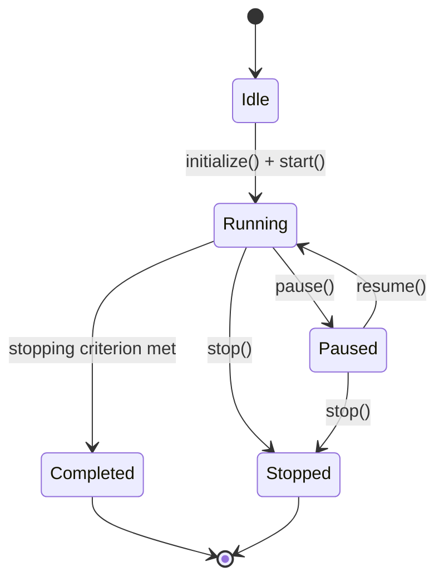

# AEGIS — Adaptive Evolutionary Guided Identification System

> **Nonlinear dynamic system identification via Differential Evolution with island model, JADE adaptive mutation, 4-phase identification curriculum, UCB1 local adaptive agent, C++ computational core, and remote LLM agent interface.**

> **Audit 2026-11.** A technical and scientific audit corrected several defects that affected numerical results (held-out data clipping, inverted stability test, masked free-run divergence, non-functional batch runner, among others) and added a typed agent interface, a fuzzy local policy, reproducible experiment tooling and benchmark provenance. See [docs/audit/](docs/audit/) and [docs/](docs/). Results published before the audit (e.g. `assets/avaliacao_cientifica.md`) were obtained with the previous code and report one-step R² on normalized data; they should not be cited as simulation performance.

AEGIS automatically identifies polynomial and rational NARX (*Nonlinear AutoRegressive with eXogenous inputs*) models from experimental data. The computational core is a C++ shared library (`aegis_core`) compiled to a native DLL on Windows and to WebAssembly on the web, bridged to a Flutter/Dart UI through a conditional FFI layer. A **UCB1 multi-armed bandit local agent** monitors the evolutionary engine in real time and autonomously adjusts DE parameters based on empirical reward signals; alternatively, a **Claude-powered remote LLM agent** can be selected via an in-app toggle to call the Anthropic API for parameter suggestions. Both agents operate within a structured **4-phase identification curriculum** that progressively expands the search space and tightens quality constraints.

---

## Table of Contents

1. [Overview](#1-overview)
2. [System Architecture](#2-system-architecture)
3. [NARX Model](#3-narx-model)
4. [Chromosome Encoding](#4-chromosome-encoding)
5. [Data Preprocessing](#5-data-preprocessing)
6. [Differential Evolution Engine](#6-differential-evolution-engine)
7. [Mutation Strategies](#7-mutation-strategies)
8. [Crossover Operators](#8-crossover-operators)
9. [Fitness Evaluation](#9-fitness-evaluation)
10. [Island Model and Migration](#10-island-model-and-migration)
11. [Stopping Criteria](#11-stopping-criteria)
12. [Model Validation and Diagnostics](#12-model-validation-and-diagnostics)
13. [Agent System](#13-agent-system)
14. [User Interface](#14-user-interface)
15. [Complete Flowchart](#15-complete-flowchart)
16. [Project Structure](#16-project-structure)
17. [Build and Execution](#17-build-and-execution)
18. [References](#18-references)

---

## 1. Overview

AEGIS solves the **system identification** problem — given an input/output dataset $\{u(k), y(k)\}_{k=1}^{N}$, automatically find:

- The model **structure** (which terms, delays, and exponents).
- The **coefficients** $\theta_j$ for each regressor.
- The **confidence level** of the representation (quality metrics).

The process is fully automated: the user loads data, assigns input/output variables, and the evolutionary engine discovers the best NARX model without manual intervention.

---

## 2. System Architecture

### 2.1 Hybrid C++ / Flutter Design

| Layer | Platform | Components | Responsibility |
|-------|----------|-----------|----------------|
| **C++ Core** | Windows (DLL) / Web (WASM) | `IdentificationPipeline` · `DEOptimizer` · `RationalModel` · `LocalRefiner` · `AgentController` | Full identification engine — DE, QR, diagnostics, WebSocket |
| **FFI Bridge** | Dart | `AegisFfiService` (native) · `AegisWasmService` (web) | Translates Dart calls ↔ C ABI (`aegis_api.h`) |
| **Dart Engine** | All platforms | `DEEngine` · `Island` · `Migration` | Pure-Dart fallback when C++ is unavailable |
| **Local Agent** | All platforms | `LocalAdaptiveAgent` | UCB1 multi-armed bandit — autonomous DE parameter tuning from reward signals |
| **Remote Agent** | Windows (native only) | `LlmAgent` | Calls Claude API every 50 generations to suggest DE tuning |
| **Agent Layer** | All platforms | `GenerationSnapshot` · `ParameterRegistry` · `GenerationHistory` | Real-time monitoring data structures |
| **Data Layer** | All platforms | `DataLoader` · `DataNormalizer` · `DataSplitter` | File parsing, normalization, partitioning |
| **UI Layer** | All platforms | Screens · Charts · Riverpod state | User interaction and visualization |

**Backend selection at runtime:**

| Platform | Computation engine | Local UCB1 Agent | Remote LLM Agent |
|----------|--------------------|------------------|------------------|
| Windows + `aegis_core.dll` | C++ via `dart:ffi` | Active | Active (reads API key from env or file) |
| Windows without DLL | Dart `DEEngine` (fallback) | Active | Active |
| Web (GitHub Pages) | Dart `DEEngine` | Active | Inactive (`dart:io` not available) |

`AegisLibrary.tryLoad()` is called in `main()`. If the DLL load fails, `EngineNotifier` silently falls back to the Dart engine. On web, conditional exports ensure `dart:ffi`, `dart:io`, and `package:ffi` are never compiled.

**Data flow:**

```
Data Layer → C++ Core (or Dart Engine) → FFI Bridge → EngineNotifier
     ↓                                                       ↓
  Snapshot (JSON via FFI / callback)       LocalAdaptiveAgent (UCB1)
                                              or LlmAgent (Claude API)
                                                       ↓
 UI Layer ← ←  ←  ←  Riverpod ←  ←  ←  applyTuning() ← ←  ┘
```

### 2.2 Design Principles

| Principle | Application |
|-----------|-------------|
| **S** — Single Responsibility | Each class solves a single problem (e.g., `CollinearityAnalyzer` only computes VIF) |
| **O** — Open/Closed | Mutation/crossover strategies are extensible abstract interfaces |
| **L** — Liskov Substitution | `AegisFfiService` and `DEEngine` are interchangeable via `EngineNotifier` |
| **I** — Interface Segregation | `MutationStrategy` and `CrossoverStrategy` are minimal contracts |
| **D** — Dependency Inversion | `EngineNotifier` depends on the abstract FFI/Dart service, not on concrete C++ types |

---

## 3. NARX Model

### 3.1 Polynomial Model

The general polynomial NARX model is:

$$y(k) = \sum_{j=1}^{n_\theta} \theta_j \prod_{m=1}^{p_j} x_{i_m}(k - \tau_m)^{\alpha_m} + e(k)$$

where:
- $y(k)$ is the output at time step $k$
- $x_{i_m}$ is the variable with index $i_m$ (input $u$ or output $y$)
- $\tau_m \geq 1$ is the delay
- $\alpha_m \in [p_{\min}, p_{\max}]$ is the exponent (core default $[0.5, 5.0]$, app default $p_{\max}=3$, quantized in steps of `exponentStep` = 0.5)
- powers use an explicit basis (`powerMode`, exported with every model): **hybrid** (default) — $x^{\alpha}$ exactly for integer $\alpha$, $\operatorname{sign}(x)\lvert x\rvert^{\alpha}$ for non-integer $\alpha$; `signed` — $\operatorname{sign}(x)\lvert x\rvert^{\alpha}$ for all $\alpha$; `legacy` — $\operatorname{sign}(x)(\lvert x\rvert+10^{-6})^{\alpha}$, the semantics of versions ≤ 9e4b1d8, kept only to reproduce old models
- $\theta_j$ is the coefficient of the $j$-th regressor
- $n_\theta$ is the number of selected regressors
- $e(k)$ is the residual

**Concrete example:**

$$y(k) = \theta_1 \cdot y(k-1) + \theta_2 \cdot u(k-1)^2 + \theta_3 \cdot u(k-2) \cdot y(k-3) + e(k)$$

### 3.2 Rational Model (with Pseudo-linearization)

For rational representations, the model takes the form:

$$y(k) = \frac{\sum_{j \in \mathcal{N}} \theta_j \varphi_j(k)}{\displaystyle 1 + \sum_{j \in \mathcal{D}} \theta_j \varphi_j(k)}$$

where $\mathcal{N}$ is the set of numerator regressors and $\mathcal{D}$ the denominator set.

**Pseudo-linearization** transforms this nonlinear problem into a linear one:

$$y(k) = \sum_{j \in \mathcal{N}} \theta_j \varphi_j(k) - \sum_{j \in \mathcal{D}} \theta_j \cdot y(k) \cdot \varphi_j(k)$$

Defining the extended regressor vector:

$$\psi_j(k) = \begin{cases} \varphi_j(k) & \text{if } j \in \mathcal{N} \text{ (numerator)} \\ -y(k) \cdot \varphi_j(k) & \text{if } j \in \mathcal{D} \text{ (denominator)} \end{cases}$$

---

## 4. Chromosome Encoding

Each individual (chromosome) encodes a candidate model structure:

```
Chromosome (C++ side: std::vector<Regressor>)
├── regressors[]
│   └── Regressor
│       ├── terms[]: { variable, delay, exponent, is_denominator }
│       └── coefficient θ
├── fitness                    // composite score (lower = better)
├── metrics: { rmse_train, rmse_val, r2, aic, bic, fpe, mdl, sse }
└── diagnostics: { stable, overfitting, underfitting, err[] }
```

The Dart-side chromosome (fallback engine) mirrors this with an immutable design — updates produce new instances via `withEvaluation()` and `withRegressors()`.

**Structural hash:** each regressor has a combinatorial hash for efficient duplicate detection:

$$h(R) = \bigoplus_{(t, \alpha) \in R} \text{hash}(t.\text{variable}, t.\text{delay}, \alpha)$$

---

## 5. Data Preprocessing

### 5.1 Loading

The `DataLoader` supports multiple formats with auto-detection:

| Format | Separators | Detection |
|--------|------------|-----------|
| CSV | `,` | Occurrence counting |
| TSV | `\t` | Occurrence counting |
| Space | ` ` | Fallback |
| Semicolon | `;` | Occurrence counting |

Options: header row (toggle), column selection, preview of the first 10 records.

### 5.2 Normalization

**C++ (`cpp/src/normalizer.cpp`):** Three strategies selectable via JSON config:

| Type | JSON key | Description |
|------|----------|-------------|
| Min-Max (default) | `"minmax"` | Maps the **training** range to $[-1.0, 1.0]$; validation/test values outside it are mapped linearly, never clipped |
| Robust | `"robust"` | Median + IQR — outlier resistant |
| Z-score | `"zscore"` | Zero mean, unit standard deviation |

**Dart fallback:** Min-Max fitted on the training prefix and scaled to $[-1.0, 1.0]$.

### 5.3 Sequential Partitioning

Data is split **sequentially** (preserving temporal order):

| Partition | Proportion | Use |
|-----------|------------|-----|
| Training | 70% | Parameter estimation $\theta$ |
| Validation | 15% | Model selection (early stopping) |
| Test | 15% | Final evaluation (unseen by engine) |

---

## 6. Differential Evolution Engine

### 6.1 State Machine



### 6.2 Execution Model

**C++ engine:** Runs on background threads (`std::thread` per island). The Dart UI polls via `Timer.periodic(200 ms)` calling `aegis_get_snapshot()` / `aegis_get_status()` through FFI.

**Dart engine (fallback):** Runs in batches of 10 generations per `Timer.periodic(16 ms)` to avoid blocking the UI thread.

### 6.3 Single Generation Cycle (per island)

For each individual $i \in \{0, \ldots, NP-1\}$:

1. **Generate adaptive parameters** $F_i$, $CR_i$ via JADE
2. **Mutation** → mutant vector $\mathbf{v}_i$
3. **Crossover** → trial vector $\mathbf{u}_i$
4. **Build regressor matrix** $\Psi$ for the trial
5. **Evaluate** → coefficients $\theta$ via QR, fitness via composite score
6. **Greedy selection**: if $f(\mathbf{u}_i) < f(\mathbf{x}_i)$, replace
7. If accepted, record $F_i$, $CR_i$ as successful

At the end of the generation:
- Update $\mu_F$, $\mu_{CR}$ via JADE
- Update stagnation counter

---

## 7. Mutation Strategies

### 7.1 DE/rand/1

$$\mathbf{v}_i = \mathbf{x}_{r_0} + F \cdot (\mathbf{x}_{r_1} - \mathbf{x}_{r_2})$$

where $r_0, r_1, r_2$ are distinct randomly chosen indices, $r_j \neq i$.

**Operation at the regressor level:** mutation perturbs exponents and delays continuously; variables mutate discretely with ~10% probability.

$$\alpha_j^{(v)} = \text{clamp}\!\left(\alpha_j^{(r_0)} + F \cdot (\alpha_j^{(r_1)} - \alpha_j^{(r_2)}),\; p_{\min},\; p_{\max}\right)$$

### 7.2 JADE — DE/current-to-pbest/1

$$\mathbf{v}_i = \mathbf{x}_i + F_i \cdot (\mathbf{x}_{p\text{-best}} - \mathbf{x}_i) + F_i \cdot (\mathbf{x}_{r_1} - \mathbf{x}_{r_2})$$

where $\mathbf{x}_{p\text{-best}}$ is randomly selected from the top-$p$ individuals:

$$p = \max\!\left(2,\; \lceil p_{\text{JADE}} \cdot NP \rceil\right), \quad p_{\text{JADE}} = 0.2 \text{ (config `jadeP`)}$$

JADE is used without the optional external archive. The C++ core also offers
classic DE/rand/1 with fixed $F$, $CR$ (`mutationStrategy: "rand1"`) for ablations.

**Adaptive parameters per individual:**

- $F_i \sim \text{Cauchy}(\mu_F, 0.1)$, regenerated if $\le 0$, truncated to $1$
- $CR_i \sim \mathcal{N}(\mu_{CR}, 0.1)$, truncated to $[0, 1]$

**End-of-generation update:**

$$\mu_F \leftarrow (1 - c)\,\mu_F + c \cdot \text{mean}_L(S_F), \qquad \mu_{CR} \leftarrow (1 - c)\,\mu_{CR} + c \cdot \overline{S_{CR}}$$

where $\text{mean}_L$ is the **Lehmer mean** and $c = 0.1$ (adaptation rate).

---

## 8. Crossover Operators

### 8.1 Binomial Crossover (Uniform)

For each gene $j \in \{1, \ldots, D\}$:

$$u_{i,j} = \begin{cases} v_{i,j} & \text{if } \text{rand}_j < CR \text{ or } j = j_{\text{rand}} \\ x_{i,j} & \text{otherwise} \end{cases}$$

### 8.2 Exponential Crossover (Segmented)

Selects a starting point $L$ and copies a contiguous segment from the mutant:

$$u_{i,j} = \begin{cases} v_{i,j} & \text{if } j \in [L, L+n) \bmod D \\ x_{i,j} & \text{otherwise} \end{cases}$$

where $n$ is the segment length, controlled by $CR$.

### 8.3 Variable-length structures (C++ core)

Chromosomes are ordered lists of regressors of different lengths. The mutant
length follows the same DE rule as the numeric genes
($n_v = \operatorname{round}(n_i + F(n_{pbest}-n_i) + F(n_{r1}-n_{r2}))$);
binomial crossover decides independently for every position, so a trial can be
**shorter or longer** than its target (in versions ≤ 9e4b1d8 a trial could
never be shorter, which biased the search towards `maxRegressors`). A
structural mutation (add / delete / replace one regressor, probability
`structuralMutationRate`) and a canonical form (no repeated factor inside a
regressor, no duplicated regressor) complete the operators.

---

## 9. Fitness Evaluation

### 9.1 Regressor Matrix Construction

For a chromosome with $k$ regressors and data with $N$ samples and maximum delay $\tau_{\max}$:

$$\Psi \in \mathbb{R}^{(N - \tau_{\max}) \times k}$$

For denominator regressors (rational model), pseudo-linearization is applied:

$$\psi_{t,j} \leftarrow -y(t) \cdot \psi_{t,j} \quad \text{if } R_j \in \mathcal{D}$$

### 9.2 Coefficient Estimation via QR

Solved numerically via QR decomposition (Householder in C++, Modified Gram-Schmidt in Dart):

$$\Psi\,\theta = \mathbf{y} \implies R\,\theta = Q^T\mathbf{y} \implies \theta_i = \frac{(Q^T\mathbf{y})_i - \sum_{j=i+1}^{k} R_{ij}\,\theta_j}{R_{ii}}$$

### 9.3 ERR — Error Reduction Ratio

$$\text{ERR}_j = \frac{(\mathbf{q}_j^T \mathbf{y})^2}{(\mathbf{q}_j^T \mathbf{q}_j)(\mathbf{y}^T \mathbf{y})}$$

where $\mathbf{q}_j$ is the $j$-th orthogonalized column (from QR of $\Psi$).

### 9.4 Composite Fitness

$$f = \text{RMSE}_{\text{val}} + \alpha \cdot \frac{\text{BIC}}{n} + \beta P_D + \gamma P_C + \delta P_E + \eta P_S + \zeta P_I + \theta \text{RMSE}_{\text{free}}$$

| Term | Penalty | Purpose |
|------|---------|---------|
| $P_D$ | `denominatorPenalty` | Penalizes rational (denominator) complexity |
| $P_C$ | `complexityPenalty` | Penalizes number of terms |
| $P_E$ | `exponentPenalty` | Penalizes exponents far from 1.0 |
| $P_S$ | `stabilityPenalty` | Singularity of the rational denominator along the data (1 if $D(k)$ changes sign, else $\max(0,(0.1-\min_k\lvert D(k)\rvert)/0.1)$) + 1 if the free-run simulation diverges (non-finite or $\lvert\hat y\rvert > 10\max\lvert y_{\text{train}}\rvert$). The previous "denominator root" test was inverted and is removed (see docs/audit). |
| $P_I$ | `noInputPenalty` ($\zeta$) | Shortfall of the input contribution $c$ below `inputContributionMin`, where $c$ is the share of the variance **not explained by the autoregressive terms** that the input-dependent terms explain (AR terms enter the ERR decomposition first) |
| $\text{RMSE}_{\text{free}}$ | `freeRunPenalty` ($\theta$) | RMSE of a free-run simulation on validation over `freeRunHorizon` steps (0 = whole split) using predicted outputs as feedback |

With `errorMode: "simulation"` the base term is the free-run RMSE over the
whole validation split and the BIC term is computed on the simulation
residuals (no separate $\theta$ term). All candidates are scored from the same
row (`maxDelay`) of each split. See [docs/CONFIGURATION.md](docs/CONFIGURATION.md).

### 9.5 Information Criteria

**BIC** (Bayesian Information Criterion):

$$\text{BIC} = n \cdot \ln\!\left(\frac{SSE}{n}\right) + k \cdot \ln(n)$$

**AIC** (Akaike Information Criterion):

$$\text{AIC} = n \cdot \ln\!\left(\frac{SSE}{n}\right) + 2k$$

---

## 10. Island Model and Migration

### 10.1 Archipelago

The engine maintains $N_I$ independent islands, each with its own RNG, population of $NP$ chromosomes, and independent JADE parameters $\mu_F$, $\mu_{CR}$.

### 10.2 Migration Topologies

| Topology | Mechanism | Characteristic |
|----------|-----------|----------------|
| **Ring** | Island $i$ sends to island $(i+1) \bmod N_I$ | Gradual propagation, balanced (the only topology of the C++ core) |
| **Star** | Best island distributes to all | Dart fallback engine only |
| **Random** | Random pairs | Dart fallback engine only |

### 10.3 Migration Protocol (C++ core)

- **Period:** every `migrationInterval` generations (default: 20)
- **Number of migrants:** $\max(1, \lfloor \text{migrationRate} \times NP \rfloor)$
- **Selection:** best individuals from the source island, re-evaluated under the destination's weights and validation window; accepted only if better than the destination's worst individual
- **Replacement:** worst individuals in destination island
- **Champion:** each generation the islands' best models are re-evaluated on the **whole** validation split with the reference weights; the best ever seen under the current weights is the reported champion

---

## 11. Stopping Criteria

Five independent criteria combined (any one triggers a stop):

| Criterion | Condition | Default |
|-----------|-----------|---------|
| **MaxGenerations** | $g \geq g_{\max}$ | 5000 |
| **StagnationLimit** | $s \geq s_{\max}$ | 500 |
| **PopulationVariance** | $\sigma^2(f) < \epsilon \;\wedge\; g > 10$ | $\epsilon = 10^{-10}$ |
| **RelativeImprovement** | $\lvert\Delta f / f_{g-w}\rvert < \delta$ | $\delta = 10^{-8}$, $w = 50$ |
| **TimeLimit** | $t_{\text{elapsed}} \geq t_{\max}$ | configurable |

---

## 12. Model Validation and Diagnostics

### 12.1 Metrics

| Metric | Formula |
|--------|---------|
| RMSE | $\sqrt{SSE / n}$ |
| $R^2$ | $1 - SS_{\text{res}} / SS_{\text{tot}}$ |
| AIC / BIC / FPE / MDL | See Section 9.5 |

### 12.2 Diagnostic Modules (C++ only)

| Module | Class | What it checks |
|--------|-------|----------------|
| `residual_analyzer.cpp` | `ResidualAnalyzer` | Autocorrelation and cross-correlation (whiteness test) |
| `stability_analyzer.cpp` | `StabilityAnalyzer` | Denominator polynomial roots (BIBO stability) |
| `collinearity_analyzer.cpp` | `CollinearityAnalyzer` | VIF — multicollinearity between regressors |
| `excitation_analyzer.cpp` | `ExcitationAnalyzer` | Persistence of excitation energy |
| `overfitting_detector.cpp` | `OverfittingDetector` | RMSE_val / RMSE_train > threshold |
| `underfitting_detector.cpp` | `UnderfittingDetector` | RMSE_train > absolute threshold |
| `automatic_pruner.cpp` | `AutomaticPruner` | Removes low-ERR / high-VIF / near-zero-coeff regressors |
| `local_refiner.cpp` | `LocalRefiner` | TRF/LM coefficient refinement for rational models |

Since the 2026-11 audit the residual, stability, over/under-fitting checks run
on the reported champion every generation, and the pruner (backward
elimination) and the refiner run once on the final champion; each change is
kept only if the validation fitness does not get worse. `ExcitationAnalyzer`,
`CollinearityAnalyzer` and `PopulationDiversityMonitor` are compiled but not
used by the pipeline. Test metrics (one-step **and** free-run, normalized and
original units) are computed once, when the run ends.

---

## 13. Agent System

AEGIS includes four agent modes selectable at runtime via the **Agent Mode** segmented button on the Agent tab. All of them act only through the typed, bounded and logged action interface of the core — see **[docs/AGENT_INTERFACE.md](docs/AGENT_INTERFACE.md)** (observation schema, action schema, rejection codes, trajectory records). The details in §13.2–§13.5 below describe the original design; where they differ, docs/AGENT_INTERFACE.md is authoritative.

| Mode | Dart class | Availability | Description |
|------|-----------|--------------|-------------|
| **Off** | — | Always | No autonomous tuning |
| **Local (UCB1)** | `LocalAdaptiveAgent` | All platforms | Heuristic candidates every 25 generations, UCB1 over (parameter, direction) arms, drift-corrected reward on validation RMSE |
| **Fuzzy** | `FuzzyPolicyAgent` | All platforms | Interpretable Takagi–Sugeno rule base (JSON), refuses to act on weak evidence |
| **Remote (Claude API)** | `LlmAgent` | Native and web (own key) | Claude Messages API (`claude-opus-5-5` by default) with JSON-schema output, timeout, call/cost budgets |

The active mode is stored in `agentModeProvider` (`StateProvider<AgentMode>`) and takes effect immediately without restarting the engine.

### 13.1 GenerationSnapshot — Indicators

Each generation produces a snapshot with fields including:

| Group | Indicator | Description |
|-------|-----------|-------------|
| **Identification** | `generation`, `elapsed` | Generation counter and wall time |
| **Global Fitness** | `bestFitness`, `meanFitness`, `stdDevFitness` | Population statistics |
| **Convergence** | `stagnationCounter`, `successRate`, `uniqueStructures` | Evolution health |
| **Diversity** | `structureEntropy`, `phenotypicDiversity` | Population spread |
| **Best Model** | `bestModelComplexity`, `bestModelRMSE`, `bestModelValidationRMSE`, `bestModelR2`, `bestModelMaxDelay` | Quality and structure |
| **Topology** | `islandSnapshots[]` | Per-island `muF`, `muCR`, stagnation, successRate |

### 13.2 Real-Time Tunable Parameters

| # | Parameter | Min | Default | Max |
|---|-----------|-----|---------|-----|
| 1 | `mutationFactor` ($F$) | 0.0 | **0.5** | 2.0 |
| 2 | `crossoverRate` ($CR$) | 0.0 | **0.9** | 1.0 |
| 3 | `populationSize` ($NP$) | 20 | **50** | 500 |
| 4 | `elitismCount` | 0 | **2** | 20 |
| 5 | `migrationInterval` | 5 | **20** | 100 |
| 6 | `migrationRate` | 0.0 | **0.1** | 0.3 |
| 7 | `maxRegressors` | 2 | **8** | 20 |
| 8 | `maxExponent` ($p_{\max}$) | 1 | **3** | 5 |
| 9 | `maxDelay` ($\tau_{\max}$) | 1 | **40** | 50 |
| 10 | `complexityPenalty` ($\gamma$) | 0.0 | **0.01** | 1.0 |
| 11 | `stagnationLimit` | 50 | **500** | 5000 |
| 12 | `reinitializationRatio` | 0.0 | **0.1** | 0.5 |
| 13 | `noInputPenalty` ($\zeta$) | 0.0 | **1.5** | 10.0 |
| 14 | `freeRunPenalty` ($\theta$) | 0.0 | **0.5** | 5.0 |
| 15 | `freeRunHorizon` | 10 | **50** | 500 |
| 16 | `phaseStagnationLimit` | 20 | **100** | 2000 |

### 13.3 Local Adaptive Agent — UCB1 Multi-Armed Bandit

`LocalAdaptiveAgent` (`lib/services/local_adaptive_agent.dart`) implements a **UCB1 (Upper Confidence Bound 1) multi-armed bandit** that autonomously selects and applies DE parameter adjustments based on empirical reward signals — no API key required.

**Core loop** (triggered every 25 generations, `cycleLength`):

1. **Collect rewards** — 50 generations after an action, compare the relative change of the champion's **validation RMSE** with the change observed in the 50 generations before the action (drift baseline). Reward $r = \text{clip}\bigl(10\,[(-\Delta_{\text{after}}) - (-\Delta_{\text{before}})],\; -1,\; +1\bigr)$. Observations that cross a curriculum phase change are inconclusive and discarded; actions rejected by the core are not counted.
2. **Build candidate pool** — `_buildCandidates()` generates context-sensitive adjustment candidates from the current snapshot (stagnation level, phase, diversity, RMSE signals).
3. **Select arm via UCB1** — untried arms get infinite priority; otherwise:

$$\text{UCB1}(a) = \bar{r}_a + c\,\sqrt{\frac{\ln N}{n_a}}$$

where $\bar{r}_a$ is average reward, $N$ is total pulls, $n_a$ is pulls for arm $a$ (an arm is a (parameter, direction) pair), and $c = 0.5$ (exploration coefficient). Moderate signals must persist for two cycles; severe signals act immediately but never bypass the per-parameter cooldown (2 cycles).

4. **Apply tuning** — calls `applyTuning(param, value)` and records a `_PendingObservation` to collect the reward after a settling window.

**Signals observed:**

| Signal | Source field | Triggers |
|--------|-------------|---------|
| Stagnation counter | `stagnationCounter` | Mutation rate increase; reinitialization trigger |
| Fitness delta | `bestFitness` trend | CR adjustment |
| Phenotypic diversity | `phenotypicDiversity` | Diversity-restore candidates |
| Current phase | `currentPhase` | Phase-appropriate candidates only |
| Per-island JADE state | `islandSnapshots[].muF`, `.muCR` | Island-specific nudges |
| Free-run RMSE | `bestModelFreeRunRmse` | `freeRunPenalty` ($\theta$) adjustment |
| Train RMSE | `bestModelRMSE` | Model quality assessment |

### 13.4 4-Phase Identification Curriculum

The C++ engine progresses through four evolutionary phases that shape the search space and fitness pressure:

| Phase | Name | Focus | Key characteristics |
|-------|------|-------|---------------------|
| 0 | **StructuralExploration** | Structural diversity | Low parsimony pressure; $\zeta \geq 1.5$ floor to force input inclusion; high structural mutation rate (0.3) |
| 1 | **NonlinearExpansion** | Widen nonlinearity | Relaxed exponent range; wider `maxDelay` search; moderate complexity pressure |
| 2 | **ParsimonyValidation** | Prune & validate | `complexityPenalty` ($\gamma$) annealed upward; stricter structural constraints; free-run evaluation enabled |
| 3 | **LocalRefinement** | Coefficient precision | Reduced $F$ and $CR$; `LocalRefiner` (TRF/LM) applied to final candidates |

Phase transitions are triggered by `phaseStagnationLimit` consecutive stagnant generations within the current phase. `LocalAdaptiveAgent` reads `currentPhase` from the snapshot and generates only phase-appropriate candidates.

### 13.5 Remote LLM Agent (Claude API)

The `LlmAgent` class monitors the engine and proposes parameter adjustments:

- **Model:** `claude-opus-5-5` (configurable), effort `medium`, raw HTTPS to `POST /v1/messages` (`anthropic-version: 2026-10-21`; Dart has no official SDK)
- **Trigger:** every 50 generations (`consultEvery`), at most one request in flight; never blocks the engine (UI) or is awaited (lockstep experiments)
- **Input:** `aegis.observation/1` (no test-set data) + the agent's previous decisions and the engine's responses
- **Output:** JSON-schema-constrained reply `{assessment, diagnosis, evidence_sufficient, actions[], rationale}`; at most one action is applied, after local and core validation; "insufficient evidence" is a valid answer
- **Safety:** 120 s timeout, call and cost budgets, refusal handling (server-side fallback opt-in), kill switch; every consultation is logged with latency, token usage and estimated cost
- **API key resolution:** constructor argument → `ANTHROPIC_API_KEY` env var → `anthropic_api_key.txt` next to the executable (never logged)

### 13.6 WebSocket Server (C++)

`cpp/src/agent_controller.cpp` implements an RFC 6455 WebSocket server on 127.0.0.1 (`webSocketPort`, disabled by default in the core; the app uses 8765). Snapshots are broadcast with a send timeout (a stalled client is disconnected and cannot block the engine); text frames are routed to the same validated action interface and logged with the source given by the client.

---

## 14. User Interface

### 14.1 Responsive Layout

| Viewport | Navigation | Breakpoint |
|----------|-----------|-----------|
| Large Desktop | Expanded `NavigationRail` (with labels) | ≥ 1200 px |
| Desktop / Tablet | Collapsed `NavigationRail` (icons only) | ≥ 768 px |
| Mobile | `BottomNavigationBar` | < 768 px |

### 14.2 Screens

| Screen | Function | Main Components |
|--------|----------|-----------------|
| **Data** | Load and assign variables | File picker, header toggle, separator selector, preview table, input/output assignment by click |
| **Evolution** | Real-time evolution monitoring | Controls (Start/Pause/Resume/Stop), KPIs (Generation, Fitness, $R^2$, Time), fitness chart, metrics |
| **Agent** | Agent control panel | Agent mode toggle (Off / Local UCB1 / Remote Claude), 12-indicator grid with semantic color, tuning sliders with reset, island monitor, ERR contribution chart |
| **Results** | Final identified model | Mathematical equation, quality metrics (RMSE/R²/AIC/BIC/FPE/MDL), ERR/coefficient table, residual autocorrelation with confidence bands, **Export JSON** button (saves full model + metrics to `.json` via file picker) |
| **How To** | In-app usage guide | Rendered from `how_to_use.md` with LaTeX support |
| **About** | Technical documentation | Rendered from `IDENTIFICATION_PROCESS.md` with LaTeX support |

### 14.3 Color Palette

Dark theme with cool gray tones and cyan accent:

| Token | Hex | Usage |
|-------|-----|-------|
| `gray950` | `#0A0A0F` | Main background |
| `gray900` | `#131318` | Card surface |
| `gray850` | `#1C1C24` | Elevated surface |
| `gray800` | `#25252F` | Borders and separators |
| `accent` | `#5EC4D4` | Cyan accent |
| `success` | `#4ADE80` | Positive indicators |
| `warning` | `#FBBF24` | Alerts |
| `error` | `#F87171` | Errors |

---

## 15. Complete Flowchart

```mermaid
flowchart TB
    A[/"Load CSV / TSV file"/] --> B["Auto-detect separator"]
    B --> C["Assign variables — Inputs / Output"]
    C --> D["Normalization (minmax / robust / zscore)"]
    D --> E["Sequential split 70% train · 15% val · 15% test"]
    E --> F{"C++ DLL available?"}

    F -->|Yes| G["aegis_configure() via FFI"]
    F -->|No| H["Dart DEEngine.initialize()"]

    G --> I["aegis_start() — background threads"]
    H --> J["Timer.periodic(16ms) — runBatch()"]

    I --> K{{"Generation loop (C++ threads)"}}
    J --> K

    K --> L["For each Island i — JADE mutation + crossover"]
    L --> M["Build Ψ · QR solve · fitness = RMSE_val + penalties"]
    M --> N["Greedy selection + JADE adaptation"]
    N --> O{"g mod migrationInterval = 0?"}
    O -->|Yes| P["Migration (Ring / Star / Random)"]
    O -->|No| Q["Build snapshot + diagnostics"]
    P --> Q

    Q --> R["FFI poll (200ms) or Dart callback → UI update"]
    R --> S["OptimizationAgent.processSnapshot() (Local UCB1 or Remote Claude)"]
    S --> T{"Agent suggests change?"}
    T -->|Yes| U["applyTuning() → C++ or Dart engine"]
    T -->|No| V{"Stopping criterion?"}
    U --> V
    V -->|No| K
    V -->|Yes| W["AutomaticPruner + LocalRefiner"]
    W --> X["aegis_get_best_model() — equation + metrics"]
    X --> Y[/"Results: Equation · RMSE · R² · AIC · BIC · Residuals · Export JSON"/]

    style A fill:#1a1a2e,stroke:#5EC4D4,color:#F4F4F8
    style Y fill:#1a1a2e,stroke:#4ADE80,color:#F4F4F8
    style F fill:#2a2a3e,stroke:#60A5FA,color:#F4F4F8
    style T fill:#2a2a3e,stroke:#FBBF24,color:#F4F4F8
    style V fill:#2a2a3e,stroke:#FBBF24,color:#F4F4F8
    style K fill:#1a1a2e,stroke:#F87171,color:#F4F4F8
```



---

## 16. Project Structure

```
AEGIS/
├── cpp/                                   # C++ computational core
│   ├── include/aegis/
│   │   ├── aegis_api.h                    # Public C API (flat ABI for dart:ffi)
│   │   ├── identification_pipeline.hpp    # Main orchestrator
│   │   ├── de_optimizer.hpp               # Multi-island JADE DE
│   │   ├── rational_model.hpp             # One-step / free-run prediction
│   │   ├── regressor_library.hpp          # Ψ matrix + QR solver
│   │   ├── individual_evaluator.hpp       # Fitness + ERR
│   │   ├── local_refiner.hpp              # TRF/LM coefficient refinement
│   │   ├── agent_controller.hpp           # RFC 6455 WebSocket server
│   │   ├── metrics.hpp                    # RMSE / R² / AIC / BIC / FPE / MDL
│   │   ├── normalizer.hpp                 # MinMax / Robust / ZScore
│   │   ├── residual_analyzer.hpp          # Autocorrelation whiteness test
│   │   ├── stability_analyzer.hpp         # BIBO stability (denominator roots)
│   │   ├── collinearity_analyzer.hpp      # VIF multicollinearity
│   │   ├── excitation_analyzer.hpp        # Persistence of excitation
│   │   ├── overfitting_detector.hpp
│   │   ├── underfitting_detector.hpp
│   │   ├── population_diversity_monitor.hpp
│   │   └── automatic_pruner.hpp
│   ├── src/                               # Implementation files (mirrors include/)
│   └── CMakeLists.txt                     # Builds aegis_core (DLL) or aegis_wasm
│
├── lib/                                   # Flutter/Dart application
│   ├── main.dart                          # Entry point — loads AegisLibrary
│   │
│   ├── ffi/                               # FFI bridge layer
│   │   ├── aegis_library.dart             # Conditional export: native vs web
│   │   ├── aegis_library_native.dart      # dart:ffi DLL loader
│   │   ├── aegis_library_web.dart         # WASM JS interop loader
│   │   ├── aegis_library_stub.dart        # No-op stub
│   │   ├── aegis_ffi_bindings.dart        # dart:ffi function typedefs
│   │   ├── aegis_ffi_service.dart         # Conditional export: native vs wasm
│   │   ├── aegis_ffi_service_native.dart  # High-level Dart wrapper (dart:ffi)
│   │   ├── aegis_ffi_service_stub.dart    # No-op stub
│   │   └── aegis_wasm_service.dart        # WASM JS interop service
│   │
│   ├── services/                          # Agent implementations and WebSocket
│   │   ├── optimization_agent.dart        # OptimizationAgent interface + AgentMode enum
│   │   ├── local_adaptive_agent.dart      # UCB1 multi-armed bandit local agent
│   │   ├── llm_agent.dart                 # Conditional export: native vs web
│   │   ├── llm_agent_native.dart          # Claude API caller (dart:io + http)
│   │   ├── llm_agent_web.dart             # Web stub (agent inactive)
│   │   ├── llm_agent_stub.dart            # No-op stub
│   │   └── agent_websocket_service.dart   # Dart WebSocket client (port 8765)
│   │
│   ├── agent/                             # Monitoring data structures
│   │   ├── generation_snapshot.dart       # Snapshot with all indicators
│   │   ├── tunable_parameter.dart         # 12 parameters + ParameterRegistry
│   │   └── generation_history.dart        # History + TuningAction log
│   │
│   ├── core/                              # Dart math foundations (fallback engine)
│   │   ├── math/                          # Matrix, QR, decompositions
│   │   ├── types/                         # Term, Regressor, Chromosome, NarxModel
│   │   └── random/                        # PRNG
│   │
│   ├── engine/                            # Pure-Dart DE engine (fallback)
│   │   ├── de/                            # Island, Population, Migration, DEEngine
│   │   ├── fitness/                       # Composite fitness, ERR calculator
│   │   ├── identification/                # Normalizer, Splitter, Validator
│   │   └── stopping/                      # 5 stopping criteria
│   │
│   ├── data/
│   │   └── data_loader.dart               # CSV/TSV/space parsing with auto-detect
│   │
│   └── ui/
│       ├── theme/app_theme.dart           # Cool gray palette + cyan accent
│       ├── state/app_state.dart           # Riverpod — EngineNotifier + providers
│       ├── screens/
│       │   ├── home_screen.dart           # Responsive shell (Rail/BottomNav)
│       │   ├── data_screen.dart           # Data loading and assignment
│       │   ├── evolution_screen.dart      # Real-time monitoring
│       │   ├── agent_dashboard_screen.dart# Agent dashboard + tuning sliders
│       │   ├── results_screen.dart        # Final model and diagnostics
│       │   ├── how_to_screen.dart         # Renders how_to_use.md with LaTeX
│       │   └── about_screen.dart          # Renders IDENTIFICATION_PROCESS.md
│       └── widgets/
│           └── stat_card.dart             # StatCard + MiniStat
│
├── assets/
│   ├── how_to_use.md                      # In-app usage guide (served as asset)
│   ├── IDENTIFICATION_PROCESS.md         # Technical reference doc
│   ├── resultado_identificacao.md        # Detailed WH identification result analysis (with figures)
│   ├── fig1.png – fig6.png               # Result figures (plots, charts, diagnostics)
│
├── web/
│   ├── how_to_use.md                      # Web build copy of usage guide
│   ├── aegis_wasm.js                      # Generated by Emscripten (CI only)
│   └── aegis_wasm.wasm                    # Generated by Emscripten (CI only)
│
├── windows/
│   ├── CMakeLists.txt                     # Flutter Windows build (no cpp subdirectory)
│   └── runner/                            # Win32 host application
│
└── .github/workflows/deploy.yml          # CI: WASM + web deploy + Windows release
```

---

## 17. Build and Execution

### Prerequisites

| Target | Tools required |
|--------|---------------|
| **Web** | Flutter SDK ≥ 3.27 · Dart ≥ 3.11 · Emscripten (for WASM) |
| **Windows** | Flutter SDK ≥ 3.27 · Dart ≥ 3.11 · MSVC 2019+ · CMake ≥ 3.17 |

### Build Commands

```bash
# Install Flutter dependencies
flutter pub get

# Static analysis
dart analyze lib

# --- Web ---
# Build C++ → WASM (requires Emscripten / emcmake)
emcmake cmake -S cpp -B cpp/build_wasm -DCMAKE_BUILD_TYPE=Release
emmake make -C cpp/build_wasm aegis_wasm -j$(nproc)
cp cpp/build_wasm/aegis_wasm.js  web/
cp cpp/build_wasm/aegis_wasm.wasm web/

# Build Flutter web (WASM compiled separately above)
flutter build web --release

# Run in browser (Dart engine only — no WASM)
flutter run -d chrome

# --- Windows ---
# Build C++ DLL
cmake -S cpp -B cpp/build_win -DCMAKE_BUILD_TYPE=Release
cmake --build cpp/build_win --config Release

# Build Flutter Windows app
flutter build windows --release

# Copy DLL next to executable
copy cpp\build_win\Release\aegis_core.dll build\windows\x64\runner\Release\
```

### Tests

```bash
# C++ core (any compiler; MinGW-w64 example). Builds aegis_core.dll (static runtime),
# aegis_batch, aegis_frols, aegis_evaluate_models, core_tests, api_tests.
cmake -S cpp -B cpp/build -G Ninja -DCMAKE_BUILD_TYPE=Release
cmake --build cpp/build
cpp/build/core_tests        # numerics, operators, determinism, JSON
cpp/build/api_tests         # C API, action interface, interruption, async, WebSocket

# Dart / Flutter (engine_consistency_test uses cpp/build/aegis_core.dll if present)
flutter test
dart analyze lib test tool
```

### Reproducible experiments

```bash
dart run tool/benchmarks/prepare_benchmarks.dart          # after downloading the raw files (docs/BENCHMARKS.md)
cpp/build/aegis_batch --data est.csv --data-test test.csv \
    --config experiments/configs/conditions/aegis_full.json --runs 10 --seed-start 1 --jobs 8 --output out/
experiments/scripts/run_protocol.sh                        # full protocol (docs/EXPERIMENTS.md)
dart run tool/experiments/analyze.dart --results experiments/results/cascaded_tanks
```

Runs are executed in lockstep (`syncMode`) with explicit seeds and are
bit-for-bit reproducible for a given binary, data and configuration.

### LLM Agent Setup (Windows)

```powershell
# Option A — environment variable
$env:ANTHROPIC_API_KEY = "sk-ant-..."

# Option B — file next to the executable
echo "sk-ant-..." > build\windows\x64\runner\Release\anthropic_api_key.txt
```

`anthropic_api_key.txt` is in `.gitignore` and is never committed.

### CI/CD (GitHub Actions)

Three automated jobs on every push to `main`:

| Job | Runner | Output |
|-----|--------|--------|
| `build-web` | ubuntu-latest | WASM + Flutter web → GitHub Pages artifact |
| `deploy-pages` | ubuntu-latest | Deploys to GitHub Pages |
| `build-windows` | windows-latest | `aegis_core.dll` + `aegis.exe` → GitHub Release (`AEGIS-windows.zip`) |

### Flutter Dependencies

| Package | Version | Usage |
|---------|---------|-------|
| `flutter_riverpod` | ^2.6.1 | Reactive state management |
| `fl_chart` | ^0.70.2 | Fitness and ERR charts |
| `file_picker` | ^8.1.6 | CSV/TSV file selection |
| `google_fonts` | ^6.2.1 | Typography (Inter) |
| `collection` | ^1.19.1 | Collection utilities |
| `ffi` | ^2.1.3 | `dart:ffi` pointer helpers (Windows) |
| `http` | ^1.3.0 | Claude API HTTP calls |
| `web_socket_channel` | ^3.0.1 | WebSocket client (external agent) |
| `markdown_widget` | ^2.3.2+6 | Markdown rendering (How To / About) |
| `flutter_math_fork` | ^0.7.2 | LaTeX rendering in docs |
| `markdown` | ^7.3.0 | Markdown parser |
| `url_launcher` | ^6.3.1 | External links |

---

## 18. References

1. **Zhang, J. & Sanderson, A. C.** (2009). JADE: Adaptive Differential Evolution with Optional External Archive. *IEEE Trans. Evolutionary Computation*, 13(5), 945–958.

2. **Billings, S. A.** (2013). *Nonlinear System Identification: NARMAX Methods in the Time, Frequency, and Spatio-Temporal Domains*. Wiley.

3. **Chen, S., Billings, S. A. & Luo, W.** (1989). Orthogonal Least Squares Methods and their Application to Non-Linear System Identification. *Int. J. Control*, 50(5), 1873–1896.

4. **Storn, R. & Price, K.** (1997). Differential Evolution — A Simple and Efficient Heuristic for Global Optimization over Continuous Spaces. *J. Global Optimization*, 11(4), 341–359.

5. **Schwarz, G.** (1978). Estimating the Dimension of a Model. *Ann. Statist.*, 6(2), 461–464.

---

<div align="center">

**AEGIS v2.1** · Adaptive Evolutionary Guided Identification System

*C++ core · Flutter/Dart UI · UCB1 Local Agent · Claude Remote Agent · 4-Phase Curriculum · Web (WASM) + Windows*

</div>
