# AEGIS — Avaliação Científica do Método
## Contribuição, Novidade, Benchmarks e Resultados

> **Documento de apoio à publicação acadêmica**
> Última atualização: 2026-06-16

---

## Sumário

1. [Problema e Contribuição](#1-problema-e-contribuição)
2. [O que é NOVO — Novidade Explícita](#2-o-que-é-novo--novidade-explícita)
3. [Configuração dos Experimentos](#3-configuração-dos-experimentos)
4. [Datasets e Sinais Usados](#4-datasets-e-sinais-usados)
5. [Benchmarks — Resultados](#5-benchmarks--resultados)
6. [Métricas de Avaliação](#6-métricas-de-avaliação)
7. [Comparação com Outros Métodos](#7-comparação-com-outros-métodos)
8. [Gráficos — Curvas de Convergência](#8-gráficos--curvas-de-convergência)
9. [Resultados Organizados](#9-resultados-organizados)
10. [Diagrama do Sistema](#10-diagrama-do-sistema)
11. [Tempo de Execução e Complexidade](#11-tempo-de-execução-e-complexidade)

---

## 1. Problema e Contribuição

### 1.1 Qual problema é resolvido?

O problema tratado é a **identificação estrutural automática de sistemas dinâmicos não-lineares**. Dado um par de séries temporais $\{u(k), y(k)\}_{k=1}^{N}$ (entrada e saída medidas de um sistema desconhecido), o objetivo é encontrar:

1. A **estrutura** do modelo — quais termos (regressores) explicam a dinâmica
2. Os **coeficientes** numéricos de cada regressor
3. Um **indicador de confiança** da representação (métricas de qualidade)

O desafio central é que o espaço de possíveis estruturas de equação é **combinatoriamente explosivo**: para $n_y$ atrasos de saída, $n_u$ atrasos de entrada, grau máximo $p$ e $k$ termos, o número de candidatos cresce como $\binom{\binom{n_y + n_u + p}{p}}{k}$. Métodos convencionais como ERR-OLS (Billings, 2013) exploram esse espaço de forma greedy e ficam presos em estruturas subótimas. Algoritmos evolutivos convencionais sem adaptação de parâmetros convertem lentamente ou requerem ajuste manual intenso.

### 1.2 O que o AEGIS faz de diferente?

O AEGIS resolve o problema com uma abordagem **totalmente automática** que combina:

- **Evolução diferencial multi-ilha com JADE** como motor de busca global — sem ajuste manual dos parâmetros $F$ e $CR$
- **Representação cromossômica dual** (polinomial + racional) com expoentes reais — maior capacidade de expressão do que modelos puramente polinomiais inteiros
- **Função de fitness com 8 componentes** incluindo penalidades específicas para dinâmica de malha fechada e para modelos que ignoram a entrada
- **Currículo de identificação em 4 fases** que guia a busca progressivamente do espaço estrutural amplo para o refinamento fino de coeficientes
- **Agente local UCB1** que controla os parâmetros do DE em tempo real sem intervenção humana, baseado em recompensas empíricas

### 1.3 Contribuições Principais (1–3 pontos)

> **C1 — Currículo evolutivo 4 fases para identificação NARX**
> Um esquema de fases progressivas (Exploração Estrutural → Expansão Não-linear → Validação por Parcimônia → Refinamento Local) que adapta automaticamente a pressão seletiva e as restrições de busca ao longo da identificação. Impede tanto a convergência prematura quanto a estagnação em estruturas subótimas.

> **C2 — Agente UCB1 multi-armed bandit para controle autônomo do DE**
> Um bandit UCB1 que observa sinais de qualidade do motor evolutivo em tempo real e seleciona e aplica ajustes de parâmetros do DE baseando-se em histórico de recompensas empíricas. Elimina a necessidade de ajuste manual dos hiperparâmetros do DE e opera em todas as plataformas sem API externa.

> **C3 — Função de fitness com penalidade de simulação livre (free-run)**
> A inclusão de $\theta \cdot \text{RMSE}_{\text{free}}$ na composição da fitness penaliza modelos que se comportam bem em modo one-step (supervisionado) mas divergem na simulação autônoma em malha fechada. Essa componente é crítica para a aplicabilidade real do modelo identificado.

---

## 2. O que é NOVO — Novidade Explícita

### O que NÃO existia antes (a esta combinação específica):

| Elemento | Estado da Arte Anterior | Novidade do AEGIS |
|---------|------------------------|-------------------|
| **DE para identificação NARX** | Existe (Storn & Price, 1997; aplicações pontuais) | Integração com currículo 4 fases e agente UCB1 adaptativo |
| **JADE (autoadaptação F e CR)** | Existe (Zhang & Sanderson, 2009) | Aplicação a espaços de busca estruturais combinatórios NARX com reinicialização e migração |
| **Multi-island DE** | Existe na literatura | Combinação com topologia anel/estrela/aleatório + migração adaptativa |
| **Representação racional NARX** | Existe (modelos NARMAX racionais, Billings 2013) | Cromossomo dual com expoentes reais e estimação QR (Householder) com degradação graciosa |
| **UCB1 para controle de hiperparâmetros evolutivos** | Existe no campo de meta-aprendizado | Aplicação específica a parâmetros do DE para identificação de sistemas, com recompensas derivadas de sinais de convergência NARX |
| **Currículo por fases para identificação** | Não encontrado na literatura NARX | **Novo** — esquema de 4 fases com transições por estagnação e pressão progressiva |
| **Penalidade free-run na fitness** | Mencionado implicitamente em trabalhos de simulação | Incorporação explícita como componente ponderada da fitness multiobjetivo com horizonte configurável |
| **Penalidade de ausência de entrada ($\zeta$)** | Não encontrado | **Novo** — força inclusão de $u$ no modelo, evita soluções puramente AR quando a entrada é relevante |

### O que o AEGIS criou especificamente:

1. **O cromossomo genético de estrutura NARX** com genes: variável, atraso, expoente real, numerador/denominador, intercept — codificação nova que permite representar tanto modelos polinomiais quanto racionais com expoentes não-inteiros em uma única representação unificada.

2. **O currículo 4 fases com agendamento automático**: transições disparadas por `phaseStagnationLimit` gerações sem melhora, com parâmetros de fitness fase-específicos (piso de $\zeta$ na fase 0, annealing de $\gamma$ na fase 2, `LocalRefiner` na fase 3).

3. **O `LocalAdaptiveAgent`** — implementação UCB1 com pool de candidatos gerado dinamicamente a partir do contexto do snapshot (fase atual, nível de estagnação, diversidade fenotípica, RMSE free-run). Cada candidato é um braço; a recompensa é a diferença entre a melhora real de fitness e a deriva de referência (baseline) no mesmo período.

4. **A composição de fitness com 8 componentes** ($\alpha$–$\theta$), incluindo as duas penalidades originais ($\zeta P_I$ e $\theta \text{RMSE}_{\text{free}}$) que não aparecem em trabalhos anteriores de identificação NARX evolutiva.

---

## 3. Configuração dos Experimentos

### 3.1 Parâmetros do Motor DE (padrão)

| Parâmetro | Símbolo | Valor | Descrição |
|-----------|---------|-------|-----------|
| Tamanho da população por ilha | $NP$ | **50** | Indivíduos por ilha |
| Número de ilhas | $N_I$ | **3** | Archipelago |
| População total | $NP \times N_I$ | **150** | Indivíduos totais |
| Fator de mutação inicial | $F_0$ | **0,5** | Controlado por JADE |
| Taxa de crossover inicial | $CR_0$ | **0,9** | Controlada por JADE |
| Limite de gerações | $g_{\max}$ | **5000** | Critério de parada |
| Limite de estagnação | $s_{\max}$ | **500** | Sem melhora global |
| Intervalo de migração | — | **20 ger.** | Ring topology padrão |
| Taxa de migração | — | **0,1** | Fração de migrantes |
| Número de migrantes | — | $\lfloor 0{,}1 \times 50 \rfloor = 5$ | Por evento |

### 3.2 Parâmetros Estruturais do Modelo

| Parâmetro | Símbolo | Valor | Descrição |
|-----------|---------|-------|-----------|
| Regressores máximos | $k_{\max}$ | **8** | Termos no numerador |
| Expoente máximo | $p_{\max}$ | **3** | Expoente real ≤ 3,0 |
| Atraso máximo | $\tau_{\max}$ | **40** | Amostras de look-back |
| Tipo de modelo | — | Polinomial + Racional | Cromossomo dual |

### 3.3 Parâmetros da Função de Fitness

| Componente | Pesos | Fase 0 | Fases 1–3 |
|-----------|-------|--------|-----------|
| $\alpha$ (BIC) | — | 0,01 | 0,01 |
| $\gamma$ (complexidade) | — | 0,001 | 0,001 → 0,05 (annealing) |
| $\zeta$ (no-input) | — | **1,5** (piso) | 0,5 |
| $\theta$ (free-run) | — | 0,0 (desativado) | **0,5** |
| `freeRunHorizon` | — | — | **50 amostras** |

### 3.4 Parâmetros do Agente UCB1

| Parâmetro | Valor | Descrição |
|-----------|-------|-----------|
| Frequência de disparo | a cada **10 gerações** | Loop de observação |
| Coeficiente de exploração | $c = 1{,}2$ | UCB1 exploration |
| Janela de settling | **5 gerações** | Delay para coletar recompensa |
| Janela de baseline | **5 gerações** | Referência de comparação |

### 3.5 Pré-processamento dos Dados

| Etapa | Método | Detalhe |
|-------|--------|---------|
| Normalização | MinMax | Ajustada somente nos 70% de treino |
| Particionamento | Sequencial 70/15/15 | Treino / Validação / Teste |
| Decimação | **Nenhuma** | Taxa original preservada |
| Critério de avaliação | $\text{RMSE}_{\text{val}}$ | Usado na fitness; teste isolado |

---

## 4. Datasets e Sinais Usados

### 4.1 Benchmark Wiener-Hammerstein (WH)

| Propriedade | Valor |
|-------------|-------|
| **Arquivo** | `WH_estimation_uy.csv` |
| **Origem** | Benchmark público SYSID — sistema físico real [1] |
| **Estrutura** | $H_1(s) \to f(\cdot) \to H_2(s)$ — filtro linear → não-linearidade estática → filtro linear |
| **Número de amostras** | **8.192** |
| **Variáveis** | `u` (entrada), `y` (saída) — normalizados |
| **Frequência de amostragem** | **78.125 Hz** |
| **Sinal de entrada** | Ruído filtrado com banda passante definida |
| **Ruído de medição** | Presente (sistema físico real, SNR não declarado pelo benchmark) |
| **Decimação** | **Nenhuma** — todos os pontos utilizados |

**Justificativa da ausência de decimação:** Os regressores NARX são definidos no tempo discreto original. Decimação alteraria implicitamente o significado físico de cada atraso — o que era $y(k{-}1)$ se tornaria $y(k{-}10)$ nos dados originais, distorcendo a dinâmica identificada.

**Particionamento utilizado:**

| Partição | Amostras | Uso |
|----------|----------|-----|
| Treino | 5.734 (70%) | Estimação de coeficientes + fitness |
| Validação | 1.229 (15%) | Seleção da estrutura (fitness) |
| Teste | 1.229 (15%) | Avaliação final — **nunca vista durante a busca** |

### 4.2 Benchmark Silverbox *(a executar)*

| Propriedade | Valor |
|-------------|-------|
| **Arquivo** | `SNLS80mV.mat` (ou CSV convertido) |
| **Origem** | Silverbox benchmark público — circuito elétrico Duffing [2] |
| **Estrutura** | Oscilador de Duffing elétrico com não-linearidade cúbica |
| **Frequência de amostragem** | 610,35 Hz |
| **Sinal de entrada** | Sinusoide multi-frequência (odd random phase) |
| **Ruído de medição** | Baixo (laboratório controlado) |

> ⚠️ **PENDENTE:** Experimento Silverbox não executado ainda. Requer: (1) conversão do arquivo `.mat`, (2) execução com mesma configuração do WH, (3) coleta de métricas.

---

## 5. Benchmarks — Resultados

### 5.1 Wiener-Hammerstein — Resultado Obtido

**Execução:** geração 2.063 (convergência antes do limite de 5.000)

#### Métricas Principais

| Métrica | Treino | Validação | Teste |
|---------|--------|-----------|-------|
| **R²** | **0,999983** | — | **0,999976** |
| **RMSE** | — | — | — |
| **Fitness composta** | **−0,4172** | — | — |

> **Nota:** O valor negativo de fitness é esperado — a função inclui componente $\text{RMSE}_{\text{val}}$ e desconto de penalidades; a fitness final próxima de $-0{,}42$ indica alta qualidade (RMSE baixo, poucas penalidades ativas).

#### Estrutura do Modelo Identificado

| Atributo | Valor |
|----------|-------|
| Tipo | Polinomial NARX |
| Atraso máximo | **9 amostras** ($\tau_{\max} = 9$) |
| Número de termos | Identificado automaticamente |
| Termos de entrada | Presentes (penalidade $\zeta$ garantiu inclusão de $u$) |
| Estabilidade | Estável (raízes do denominador dentro do círculo unitário) |
| Resíduos | Brancura validada (autocorrelação dentro das bandas de confiança) |

**Geração de convergência por fase (estimado):**

| Fase | Foco | Gerações (aprox.) |
|------|------|-------------------|
| 0 — StructuralExploration | Diversidade estrutural | 1 – 400 |
| 1 — NonlinearExpansion | Expansão não-linear | 401 – 900 |
| 2 — ParsimonyValidation | Poda + validação | 901 – 1.800 |
| 3 — LocalRefinement | Refinamento fino | 1.801 – 2.063 |

#### Equação identificada (representação simbólica)

A equação identificada tem a forma:

$$\hat{y}(k) = \theta_0 + \sum_{j=1}^{n_\theta} \theta_j \prod_{m=1}^{p_j} x_{i_m}(k - \tau_m)^{\alpha_m}$$

onde os regressores incluem termos de $y(k{-}1)$ até $y(k{-}9)$ e $u(k{-}\tau)$ com expoentes reais identificados pelo motor evolutivo.

---

### 5.2 Silverbox — *(PENDENTE)*

| Métrica | AEGIS | *a executar* |
|---------|-------|-------------|
| R² (teste) | — | — |
| RMSE (teste) | — | — |
| Gerações | — | — |
| Fitness | — | — |

> ⚠️ **PENDENTE:** Carregar dataset, executar com mesma configuração, registrar métricas.

---

### 5.3 Estatísticas de Múltiplas Execuções *(PENDENTE)*

Para estabelecer robustez do método, são necessárias **N ≥ 10 execuções independentes** (seeds aleatórias diferentes) em cada benchmark.

| Benchmark | N execuções | R² (média ± dp) | RMSE (média ± dp) | Ger. conv. (média) |
|-----------|------------|-----------------|-------------------|---------------------|
| Wiener-Hammerstein | 1 (atual) | 0,9999 | — | 2.063 |
| Wiener-Hammerstein | *a executar (10x)* | — | — | — |
| Silverbox | *a executar (10x)* | — | — | — |

> ⚠️ **PENDENTE:** Implementar loop de múltiplas execuções com diferentes sementes RNG e registrar mean ± std para cada métrica.

---

## 6. Métricas de Avaliação

### 6.1 Métricas Utilizadas

| Métrica | Fórmula | Uso |
|---------|---------|-----|
| **RMSE** | $\sqrt{\frac{1}{n}\sum(y_k - \hat{y}_k)^2}$ | Erro principal — treino e teste |
| **R²** | $1 - \frac{\sum(y_k - \hat{y}_k)^2}{\sum(y_k - \bar{y})^2}$ | Coeficiente de determinação |
| **RMSE free-run** | RMSE em simulação autônoma de $H$ passos | Qualidade em malha fechada |
| **BIC** | $n \ln(\text{SSE}/n) + k \ln(n)$ | Penalidade de complexidade |
| **AIC** | $n \ln(\text{SSE}/n) + 2k$ | Alternativa ao BIC |
| **FPE** | $\frac{n + k}{n - k} \cdot \text{SSE}/n$ | Final Prediction Error |
| **MDL** | $n \ln(\text{SSE}/n) + k \ln(n)/2$ | Minimum Description Length |
| **ERR** | $\frac{(\mathbf{q}_j^T \mathbf{y})^2}{(\mathbf{q}_j^T \mathbf{q}_j)(\mathbf{y}^T \mathbf{y})}$ | Contribuição individual de cada regressor |

### 6.2 Métricas Primárias para Comparação

Para comparação direta entre métodos, as métricas primárias são:

1. **R² no conjunto de teste** — métrica principal (maior é melhor)
2. **RMSE no conjunto de teste** — erro absoluto (menor é melhor)
3. **Gerações até convergência** — eficiência computacional
4. **RMSE de múltiplas execuções** — robustez: $\mu \pm \sigma$ de N ≥ 10 runs

### 6.3 Protocolo de Avaliação Justa

Para garantir comparação justa entre métodos:
- **Mesmo dataset**, **mesma partição** 70/15/15 sequencial
- **Mesmo orçamento** de avaliações de fitness (ex.: $150 \times 5000 = 750.000$ avaliações)
- **Mesma representação NARX** (mesmos $\tau_{\max}$, $k_{\max}$, $p_{\max}$)
- **Mesma semente ou distribuição de sementes** para reprodutibilidade
- Métricas calculadas **exclusivamente no conjunto de teste** (nunca no conjunto de validação usado para fitness)

---

## 7. Comparação com Outros Métodos

### 7.1 Métodos a Comparar

| ID | Método | Variante | Referência |
|----|--------|---------|-----------|
| **M1** | **AEGIS** | DE multi-ilha JADE + UCB1 + Currículo 4 fases | Este trabalho |
| **M2** | DE Clássico | $F = 0{,}5$, $CR = 0{,}9$ fixos, 1 ilha, sem agente | Storn & Price (1997) |
| **M3** | DE + JADE | JADE sem multi-ilha e sem currículo | Zhang & Sanderson (2009) |
| **M4** | GA | Codificação binária ou real, torneio | Goldberg (1989) |
| **M5** | PSO | Inércia decrescente, $w = 0{,}9 \to 0{,}4$ | Kennedy & Eberhart (1995) |
| **M6** | ERR-OLS | Seleção greedy ortogonal (baseline) | Billings (2013) |

### 7.2 Tabela de Resultados — Wiener-Hammerstein *(parcial)*

| Método | R² (teste) | RMSE (teste) | Ger./Iterações | Tempo (s) | Obs. |
|--------|-----------|-------------|----------------|-----------|------|
| **AEGIS (M1)** | **0,999976** | — | **2.063** | — | 1 execução |
| DE Clássico (M2) | *pendente* | *pendente* | *pendente* | *pendente* | a executar |
| DE + JADE (M3) | *pendente* | *pendente* | *pendente* | *pendente* | a executar |
| GA (M4) | *pendente* | *pendente* | *pendente* | *pendente* | a executar |
| PSO (M5) | *pendente* | *pendente* | *pendente* | *pendente* | a executar |
| ERR-OLS (M6) | *pendente* | *pendente* | N/A (batch) | *pendente* | baseline |

> ⚠️ **PENDENTE:** Implementar M2–M6 com a mesma representação cromossômica e mesmo dataset, coletar resultados em ≥ 10 execuções cada.

### 7.3 Condições Idênticas para Comparação Justa

Todos os métodos devem usar:

```
Dataset:        WH_estimation_uy.csv (8.192 amostras)
Partição:       70% treino / 15% val / 15% teste (sequencial)
Normalização:   MinMax ajustada nos 70% de treino
τ_max:          40 amostras
k_max:          8 regressores
p_max:          3 (expoente máximo)
Avaliações:     150 × 5000 = 750.000 (orçamento fixo)
Execuções:      10 (seeds 0 a 9)
Fitness:        RMSE_val + mesmo conjunto de penalidades
```

### 7.4 Hipóteses Esperadas

Com base na literatura e no resultado WH já obtido:

- **AEGIS vs DE Clássico (M2):** AEGIS deve convergir em menos gerações e com menor desvio padrão entre execuções, pois JADE adapta $F$ e $CR$ e o currículo reduz o risco de convergência prematura.
- **AEGIS vs DE+JADE sem currículo (M3):** A diferença deve mostrar o efeito do currículo — sem ele, espera-se maior variância entre execuções e maior número de gerações para convergir.
- **AEGIS vs GA/PSO (M4/M5):** GA e PSO tendem a ser menos eficientes em espaços combinatórios de alta dimensão com estruturas de dependência complexas (regressores NARX).
- **AEGIS vs ERR-OLS (M6):** ERR-OLS é o método de referência do estado da arte para seleção de regressores NARX. Esperamos que o AEGIS seja competitivo ou superior em sistemas com não-linearidade forte, onde ERR-OLS pode ficar preso em ótimos locais.

---

## 8. Gráficos — Curvas de Convergência

### 8.1 Gráficos Necessários

#### G1 — Curva de Convergência do AEGIS (WH)

- **Eixo X:** geração (0 a 2.063)
- **Eixo Y:** fitness composta (melhor indivíduo global)
- **Séries:** curva suavizada + curva bruta (por geração)
- **Anotações:** transições de fase (0→1, 1→2, 2→3)
- **Status:** dados disponíveis no `fitnessHistoryProvider` — **gerar gráfico**

```
Fitness
  0 ┤
    │                           •••••••••••••••••••••
-0.1┤              ••••••••••••
    │         •••••
-0.2┤    •••••
    │  ••
-0.3┤ •
    │•
-0.4┤                                                   ← convergência -0.4172
    └───────────────────────────────────────────────────► Geração
   0     |fase0→1|     |fase1→2|        |fase2→3| 2063
```

#### G2 — Comparação de Convergência entre Métodos *(pendente)*

- **Eixo X:** avaliações de fitness (escala comum)
- **Eixo Y:** melhor fitness / R²
- **Séries:** M1 a M5 (cores distintas)
- **Status:** ⚠️ pendente experimentos M2–M5

#### G3 — Saída Prevista vs. Saída Real *(gerar)*

- **Eixo X:** amostras do conjunto de teste (1.229 pontos)
- **Eixo Y:** amplitude normalizada
- **Séries:** $y(k)$ (real, pontilhado) e $\hat{y}(k)$ (previsto, sólido)
- **Status:** dados disponíveis após `aegis_get_best_model()` — **gerar gráfico**

#### G4 — Resíduo e Autocorrelação *(disponível na UI)*

- **Painel 1:** resíduo $e(k) = y(k) - \hat{y}(k)$ no tempo
- **Painel 2:** função de autocorrelação de $e(k)$ com bandas $\pm 1{,}96/\sqrt{N}$
- **Status:** disponível na tela **Results** do AEGIS — **exportar figura**

#### G5 — Contribuição ERR dos Regressores *(disponível na UI)*

- **Tipo:** gráfico de barras horizontais
- **Eixo X:** ERR (%)
- **Eixo Y:** regressores em ordem decrescente de contribuição
- **Status:** disponível na tela **Agent** do AEGIS — **exportar figura**

#### G6 — Boxplot de Múltiplas Execuções *(pendente)*

- **Tipo:** boxplot por método
- **Eixo Y:** R² no teste
- **Grupos:** M1 a M5
- **Status:** ⚠️ pendente N=10 execuções por método

---

## 9. Resultados Organizados

### 9.1 Resultado Principal — WH (AEGIS, 1 execução)

```
┌─────────────────────────────────────────────────────────────────┐
│          AEGIS — Wiener-Hammerstein — Resultado Final           │
├─────────────────────┬───────────────────────────────────────────┤
│ Gerações            │ 2.063 (de 5.000 máximo)                  │
│ Fitness final       │ −0,4172                                   │
│ R² (treino)         │ 0,999983                                  │
│ R² (teste)          │ 0,999976                                  │
│ Tipo do modelo      │ Polinomial NARX                           │
│ Atraso máximo       │ 9 amostras                                │
│ Estabilidade        │ Estável                                   │
│ Resíduos            │ Brancos (dentro das bandas de confiança)  │
│ Fase final          │ LocalRefinement (fase 3)                  │
│ Agente              │ UCB1 (local) — ativo durante toda a busca │
└─────────────────────┴───────────────────────────────────────────┘
```

### 9.2 Tabela de Métricas de Qualidade (WH)

| Métrica | Treino | Validação | Teste |
|---------|--------|-----------|-------|
| R² | 0,999983 | — | 0,999976 |
| $1 - R^2$ | $1{,}7 \times 10^{-5}$ | — | $2{,}4 \times 10^{-5}$ |
| RMSE | — | — | — |
| AIC | — | — | — |
| BIC | — | — | — |

> Valores de RMSE/AIC/BIC: disponíveis no JSON exportado pelo botão "Exportar JSON" da tela Results.

### 9.3 Tabela Comparativa Final *(a completar)*

| Método | R² (média) | R² (dp) | RMSE (média) | Conv. ger. (média) | Tempo médio |
|--------|-----------|---------|-------------|---------------------|-------------|
| **AEGIS** | **0,9999** | *\[10x]* | *\[10x]* | **2.063** | *\[medir]* |
| DE Clássico | *pend.* | *pend.* | *pend.* | *pend.* | *pend.* |
| DE + JADE | *pend.* | *pend.* | *pend.* | *pend.* | *pend.* |
| GA | *pend.* | *pend.* | *pend.* | *pend.* | *pend.* |
| PSO | *pend.* | *pend.* | *pend.* | *pend.* | *pend.* |
| ERR-OLS | *pend.* | N/A | *pend.* | N/A | *pend.* |

---

## 10. Diagrama do Sistema

```mermaid
flowchart TB
    subgraph PRE["Pré-processamento"]
        A[/"CSV: u(k), y(k)"/] --> B["MinMax (ajuste nos 70% treino)"]
        B --> C["Split sequencial 70/15/15"]
    end

    subgraph INIT["Inicialização"]
        D["Gerar população inicial (NP×NI cromossomos aleatórios)"]
        D --> E["Fase 0: StructuralExploration\n(ζ_floor=1.5, mutRate=0.3)"]
    end

    subgraph LOOP["Loop Evolutivo — JADE Multi-ilha"]
        F{{"Para cada ilha i = 1..NI"}}
        F --> G["Mutação DE/rand/1 com F~Cauchy(μF)"]
        G --> H["Crossover binomial com CR~Normal(μCR)"]
        H --> I["Avaliar candidato:\nΨ → QR → RMSE_val + 8 penalidades"]
        I --> J{"Candidato melhor?"}
        J -->|Sim| K["Substituir + atualizar μF, μCR (JADE)"]
        J -->|Não| L["Descartar"]
        K --> M{"g mod 20 = 0?"}
        M -->|Sim| N["Migração Ring/Star/Random"]
    end

    subgraph AGENT["Agente UCB1 — a cada 10 ger."]
        O["Coletar recompensas das obs. pendentes"]
        O --> P["_buildCandidates() → pool dinâmico"]
        P --> Q["UCB1: selecionar braço (arg max)"]
        Q --> R["applyTuning(param, value)"]
        R --> S["Registrar _PendingObservation"]
    end

    subgraph PHASE["Gestão de Fases"]
        T{"phaseStagnation ≥ limit?"}
        T -->|Sim| U["Avançar fase (0→1→2→3)"]
        T -->|Não| V["Manter fase atual"]
    end

    subgraph STOP["Critérios de Parada"]
        W{"g ≥ 5000 OU\nStagnação ≥ 500 OU\nVariância < ε?"}
    end

    subgraph POST["Pós-processamento"]
        X["AutomaticPruner (ERR/VIF/coef)\nLocalRefiner (TRF/LM)"]
        X --> Y[/"Modelo NARX: equação + R² + RMSE + ERR + Resíduos"/]
    end

    C --> D
    L --> F
    N --> F
    F --> T
    T --> W
    W -->|Não| AGENT
    AGENT --> F
    W -->|Sim| X

    style A fill:#1a1a2e,stroke:#5EC4D4,color:#F4F4F8
    style Y fill:#1a1a2e,stroke:#4ADE80,color:#F4F4F8
    style W fill:#2a2a3e,stroke:#FBBF24,color:#F4F4F8
    style T fill:#2a2a3e,stroke:#60A5FA,color:#F4F4F8
```



---

## 11. Tempo de Execução e Complexidade

### 11.1 Complexidade Computacional por Geração

A operação dominante em cada geração é a **construção e solução da matriz de regressores** $\Psi$:

| Operação | Complexidade | Detalhe |
|----------|-------------|---------|
| Construção de $\Psi$ | $O(N \cdot k)$ | $N$ = amostras, $k$ = regressores |
| Decomposição QR (Householder) | $O(N \cdot k^2)$ | Solver principal |
| Avaliação de fitness | $O(N \cdot k)$ | RMSE + penalidades |
| Simulação free-run | $O(H \cdot k)$ | $H$ = horizonte (50 passos) |
| **Por geração (total)** | $O(NP \cdot N_I \cdot N \cdot k^2)$ | Paralelizado por ilha |

Para a configuração WH: $NP = 150$, $N = 5.734$, $k \leq 8$ → aprox. $10^7$ operações/geração.

### 11.2 Tempo Medido (WH — 1 execução)

| Etapa | Tempo |
|-------|-------|
| Gerações totais | 2.063 |
| Tempo total (estimado) | *a medir com cronômetro preciso* |
| Tempo médio por geração | *a medir* |
| Tempo de pós-processamento | *a medir* |

> ⚠️ **PENDENTE:** Instrumentar o timer no C++ (`std::chrono`) e registrar tempo total e por geração. O timer de parede (`elapsed`) já está disponível no snapshot Dart mas não está sendo persistido no JSON de resultado.

### 11.3 Configuração de Hardware (a documentar)

| Item | Especificação |
|------|--------------|
| CPU | *registrar modelo* |
| RAM | *registrar capacidade* |
| SO | Windows 11 |
| Compilador | MSVC (Release, /O2) |
| Threads | *registrar — C++ usa threads separadas por ilha* |

### 11.4 Escalabilidade

| Variável | Efeito no tempo |
|---------|----------------|
| $NP$ (população) | Linear — $2\times NP$ ≈ $2\times$ tempo/ger. |
| $N_I$ (ilhas) | Sub-linear com paralelismo; linear sem |
| $N$ (amostras) | Linear (construção de $\Psi$) |
| $k$ (regressores) | Quadrático (QR) |
| $\tau_{\max}$ (atraso) | Afeta $N_{\text{efetivo}} = N - \tau_{\max}$ (pequeno efeito) |

---

## Referências

1. **Wiener-Hammerstein Benchmark** — SYSID 2009: J. Schoukens et al. "Wiener-Hammerstein benchmark." *15th IFAC Symposium on System Identification*, 2009.

2. **Silverbox Benchmark** — J. P. Noel & M. Schoukens. "A nonlinear state space approach to hysteresis identification." *Mechanical Systems and Signal Processing*, 2017.

3. **Zhang, J. & Sanderson, A. C.** (2009). JADE: Adaptive Differential Evolution with Optional External Archive. *IEEE Trans. Evolutionary Computation*, 13(5), 945–958.

4. **Billings, S. A.** (2013). *Nonlinear System Identification: NARMAX Methods in the Time, Frequency, and Spatio-Temporal Domains*. Wiley.

5. **Storn, R. & Price, K.** (1997). Differential Evolution — A Simple and Efficient Heuristic for Global Optimization over Continuous Spaces. *J. Global Optimization*, 11(4), 341–359.

6. **Auer, P., Cesa-Bianchi, N. & Fischer, P.** (2002). Finite-time Analysis of the Multiarmed Bandit Problem. *Machine Learning*, 47, 235–256.

7. **Chen, S., Billings, S. A. & Luo, W.** (1989). Orthogonal Least Squares Methods and their Application to Non-Linear System Identification. *Int. J. Control*, 50(5), 1873–1896.

---

## Checklist de Pendências para Publicação

- [ ] **Múltiplas execuções WH** — 10 runs independentes (seeds 0–9), registrar R² e RMSE com mean±std
- [ ] **Benchmark Silverbox** — carregar dataset, executar AEGIS, registrar métricas
- [ ] **Implementar métodos M2–M5** (DE clássico, DE+JADE, GA, PSO) na mesma representação
- [ ] **Comparação justa** — M1 vs M2–M5, mesmo orçamento, mesmo dataset, 10 runs cada
- [ ] **Medir tempo de execução** — instrumentar C++ com `std::chrono`, registrar por execução
- [ ] **Gráfico G1** — exportar curva de convergência do AEGIS (fitness vs. geração com fases)
- [ ] **Gráfico G2** — curvas de convergência comparativas M1 vs M2–M5
- [ ] **Gráfico G3** — saída prevista vs. real no conjunto de teste (WH e Silverbox)
- [ ] **Gráfico G6** — boxplot R² de múltiplas execuções por método
- [ ] **Completar tabela 9.3** com resultados de todos os métodos
- [ ] **Documentar hardware** — CPU, RAM, threads usadas
- [ ] **Verificar referências** — confirmar que Silverbox (ref. 2) é a fonte correta do dataset usado

---

<div align="center">

*Documento de avaliação científica — AEGIS v2.1*

*Para questões sobre o método, consulte também:*
*`assets/resultado_identificacao.md` (interpretação do resultado WH)*
*`README_BR.md` (documentação técnica completa)*

</div>
