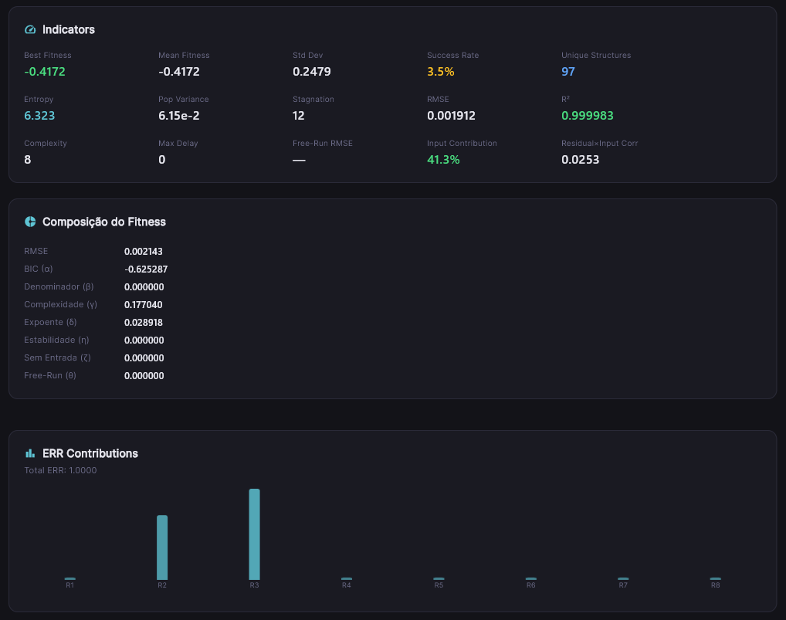
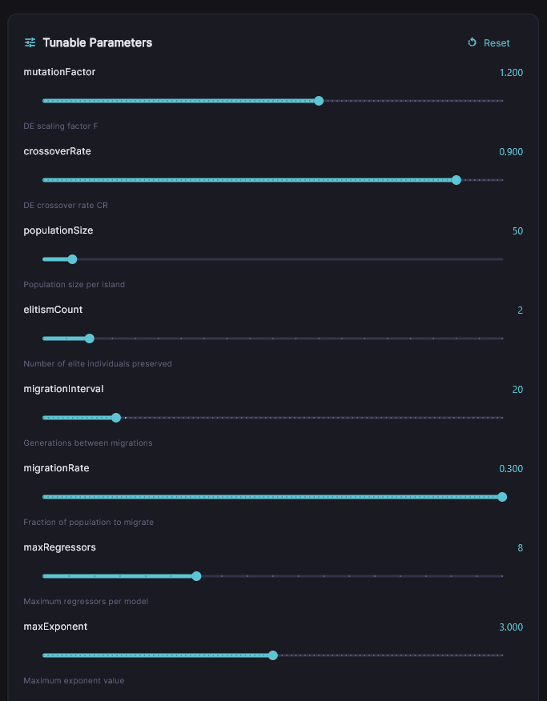
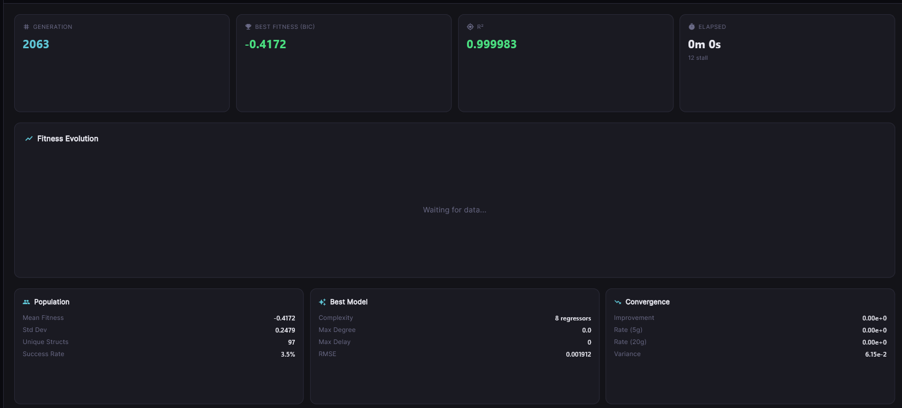
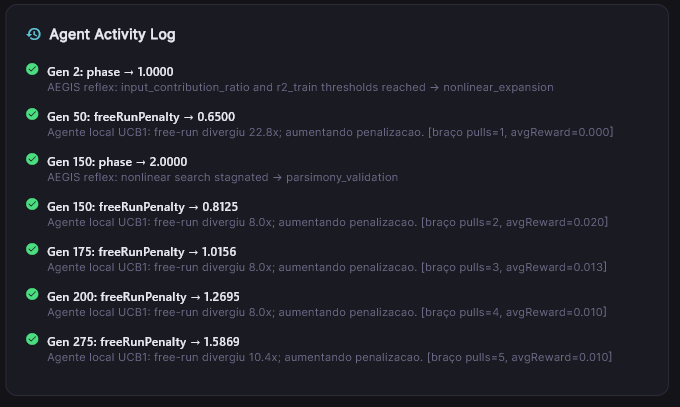
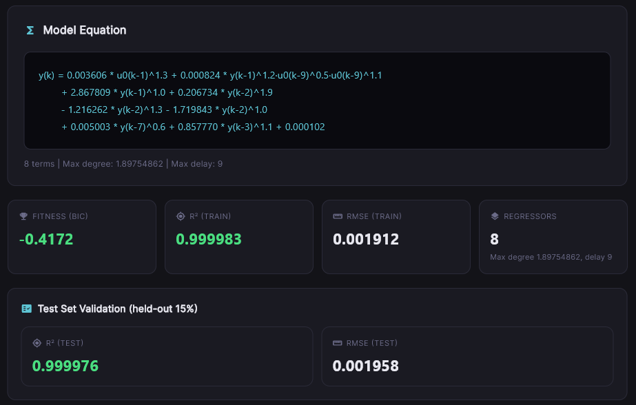
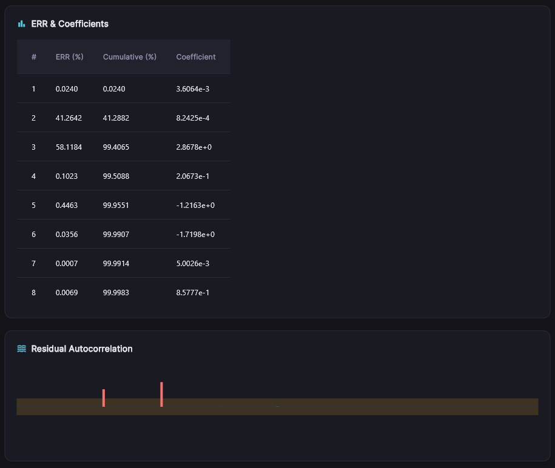

# AEGIS — Resultado da Identificação do Sistema Wiener-Hammerstein
## Guia Detalhado de Leitura e Interpretação

---

## Sumário

1. [O que é o AEGIS](#1-o-que-é-o-aegis)
2. [Os Dados de Entrada](#2-os-dados-de-entrada)
3. [O Sistema Alvo — Wiener-Hammerstein](#3-o-sistema-alvo--wiener-hammerstein)
4. [Representação do Modelo — NARX](#4-representação-do-modelo--narx)
5. [O Motor de Busca — Differential Evolution com JADE](#5-o-motor-de-busca--differential-evolution-com-jade)
6. [O Currículo por Fases](#6-o-currículo-por-fases)
7. [A Fitness e sua Composição](#7-a-fitness-e-sua-composição)
8. [O Agente Local UCB1](#8-o-agente-local-ucb1)
9. [Os Parâmetros Ajustáveis](#9-os-parâmetros-ajustáveis)
10. [O Monitor de Evolução — Leitura do Dashboard](#10-o-monitor-de-evolução--leitura-do-dashboard)
11. [O Painel de Indicadores e Composição do Fitness](#11-o-painel-de-indicadores-e-composição-do-fitness)
12. [O Log de Atividade do Agente](#12-o-log-de-atividade-do-agente)
13. [O Resultado Final — Modelo Identificado](#13-o-resultado-final--modelo-identificado)
14. [ERR — Contribuição dos Regressores](#14-err--contribuição-dos-regressores)
15. [Autocorrelação dos Resíduos](#15-autocorrelação-dos-resíduos)
16. [Conclusão](#16-conclusão)

---

## 1. O que é o AEGIS

O **AEGIS** (Adaptive Evolutionary Guided Identification System) é uma ferramenta de identificação de sistemas dinâmicos não-lineares. A tarefa é: dado um sinal de entrada `u(t)` e um sinal de saída medido `y(t)`, encontrar automaticamente uma **equação matemática** que descreva como `u` produz `y`.

O processo é completamente automático — o AEGIS usa evolução diferencial para explorar um espaço enorme de possíveis estruturas de equação, avaliando cada candidata e selecionando as melhores ao longo de milhares de gerações.

```
           ┌──────────────────────────────────────────┐
  u(k) ───►│  Modelo identificado: y_hat(k) = f(...)  │───► y_hat(k)
           └──────────────────────────────────────────┘
                         ≈
  u(k) ───► [Sistema real Wiener-Hammerstein] ───► y(k)
```

A métrica de sucesso é: `y_hat(k) ≈ y(k)` com R² próximo de 1 em dados **nunca vistos** durante a busca.

---

## 2. Os Dados de Entrada

**Arquivo:** `WH_estimation_uy.csv`

| Propriedade | Valor |
|-------------|-------|
| Número de amostras | 8.192 |
| Colunas | `u` (entrada), `y` (saída) |
| Frequência de amostragem | **78.125 Hz** |
| Duração total | ≈ 0,105 segundos |
| Decimação | **Nenhuma** — todos os pontos são usados |

### Por que não há decimação?

A identificação NARX trabalha com **regressores no tempo discreto**: `y(k-1)`, `y(k-2)`, `u(k-1)`, etc. O significado físico de cada atraso depende diretamente da frequência de amostragem. Se decimássemos os dados (ex.: pegar 1 a cada 10 amostras), estaríamos alterando implicitamente a dinâmica do sistema — o que era `y(k-1)` passaria a ser `y(k-10)` nos dados originais. Para preservar a fidelidade da dinâmica temporal, nenhuma decimação é aplicada.

**Consequência prática:** com fs=78.125 Hz, amostras consecutivas são muito correlacionadas entre si (o sistema não muda muito em 12,8 µs). Isso torna o problema do solver QR mais desafiador — regressores como `y(k-1)` e `y(k-2)` são quase colineares, exigindo tratamento especial no solver de mínimos quadrados.

### Divisão dos dados (sequencial)

Os dados são divididos **em ordem temporal** — nunca embaralhados:

```
|───────────────── 70% Treino ──────────────────|── 15% Val ──|── 15% Teste ──|
amostras 0 a 5733                             5733 a 6963   6963 a 8191
```

- **Treino (70%):** usado para estimar os coeficientes de cada modelo candidato durante a evolução
- **Validação (15%):** usado para avaliar a generalização durante a evolução e para o critério BIC
- **Teste (15%):** **completamente isolado** — nunca visto durante a busca, usado apenas para o resultado final

### Normalização

Antes de qualquer cálculo, os dados são normalizados com **MinMax** ajustado apenas no conjunto de treino:

```
x_norm = (x - x_min_treino) / (x_max_treino - x_min_treino) × (hi - lo) + lo
```

Com `lo = -1.0` e `hi = 1.0`. Os parâmetros de normalização do treino são aplicados também ao conjunto de validação e teste — assim não há "vazamento" de informação futura para o processo de ajuste.

---

## 3. O Sistema Alvo — Wiener-Hammerstein

O **Wiener-Hammerstein** (WH) é uma das estruturas de sistemas não-lineares mais estudadas em identificação de sistemas. É uma cascata de três blocos:

```
              ┌──────────┐    ┌──────────────┐    ┌──────────┐
  u(t) ──────►│ Filtro   │───►│  Não-linear  │───►│  Filtro  │──────► y(t)
              │ linear   │    │  estática    │    │  linear  │
              │ H₁(s)    │    │  f(·)        │    │ H₂(s)    │
              └──────────┘    └──────────────┘    └──────────┘
```

1. **H₁(s):** filtro linear de entrada (molda o espectro da excitação)
2. **f(·):** não-linearidade estática (sem memória) — ex.: saturação, polinômio
3. **H₂(s):** filtro linear de saída (molda o espectro da resposta)

O desafio: do ponto de vista externo (`u` e `y`), esse sistema parece um único bloco negro. A identificação NARX captura a dinâmica combinada sem separar explicitamente os três blocos — o modelo resultante é uma equação de diferenças que reproduz o comportamento entrada-saída com altíssima fidelidade.

---

## 4. Representação do Modelo — NARX

O AEGIS identifica modelos da classe **NARX racional** (Nonlinear AutoRegressive with eXogenous inputs):

```
y_hat(k) = f( y(k-1), y(k-2), ..., y(k-ny), u(k-1), u(k-2), ..., u(k-nu) )
```

Onde `f(·)` é uma combinação linear de **regressores não-lineares**:

```
y_hat(k) = θ₁·φ₁(k) + θ₂·φ₂(k) + ... + θₙ·φₙ(k) + θ₀
```

Cada regressor `φⱼ(k)` é um **produto de termos com expoentes reais**:

```
φⱼ(k) = x_v₁(k-d₁)^p₁ · x_v₂(k-d₂)^p₂ · ...
```

- `v`: índice da variável — `0` para `u` (entrada), `1` para `y` (saída)
- `d`: atraso (≥ 1 amostra)
- `p`: expoente real (ex.: 0.5, 1.0, 1.3, 1.9 — não precisa ser inteiro)
- `θ`: coeficiente linear (estimado por mínimos quadrados)

**Exemplo de regressor simples:** `y(k-1)^1.0` — apenas a saída com 1 atraso, linear  
**Exemplo de regressor cruzado:** `y(k-1)^1.2 · u(k-9)^0.5 · u(k-9)^1.1` — produto de três termos

Os coeficientes `θ` são estimados por **mínimos quadrados via solver QR (Householder)** — exato, sem iteração, dado o cromossomo (estrutura) fixo.

---

## 5. O Motor de Busca — Differential Evolution com JADE

A identificação da **estrutura** (quais regressores, quais atrasos, quais expoentes) é um problema de otimização combinatória — não há gradiente analítico. O AEGIS usa **Differential Evolution (DE)** com adaptação automática dos parâmetros (**JADE**) organizado em **múltiplas ilhas**.

### O que é uma geração?

Cada **geração** é uma rodada de evolução sobre toda a população:

```
Para cada indivíduo (cromossomo) na população:
  1. Selecionar três outros indivíduos aleatórios (r1, r2, pbest)
  2. Criar mutante: v = x_atual + F·(x_pbest - x_atual) + F·(x_r1 - x_r2)
  3. Crossover binomial: misturar v com x_atual → trial
  4. Avaliar fitness(trial): estimar coeficientes QR, calcular RMSE, BIC, penalidades
  5. Seleção gulosa: if fitness(trial) < fitness(atual) → substituir
```

O **cromossomo** é a estrutura do modelo: lista de regressores, cada um com seus termos (variável, atraso, expoente).

### JADE — Adaptação automática

O `F` (fator de mutação) e o `CR` (taxa de crossover) **se adaptam automaticamente** a cada geração, aprendendo quais valores levam a melhores soluções. Não há necessidade de ajuste manual desses parâmetros — eles convergem para os valores ótimos para o problema atual.

### Estrutura de ilhas

O AEGIS mantém **3 ilhas independentes** com papéis especializados:

| Ilha | Papel | Pressão seletiva |
|------|-------|-----------------|
| 0 | Balanced | Geral — equilíbrio entre RMSE e complexidade |
| 1 | Parsimony | Favorece modelos menores e mais simples |
| 2 | FreeRunFidelity | Prioriza modelos com boa simulação livre (estabilidade) |

A cada **20 gerações** (padrão), os melhores indivíduos de cada ilha **migram** para as outras ilhas — injetando diversidade e permitindo que soluções boas se espalhemm pela população global.

---

## 6. O Currículo por Fases

O AEGIS não busca o modelo final desde o início. Ele segue um **currículo progressivo de 4 fases**, aumentando gradualmente a dificuldade e os pesos das penalidades:

```
Fase 0                    Fase 1                    Fase 2                    Fase 3
StructuralExploration ──► NonlinearExpansion ──► ParsimonyValidation ──► LocalRefinement
(gen 0–2)                (gen 2–150)              (gen 150+)               (fase final)
```

### Fase 0 — Exploração Estrutural (StructuralExploration)

- **Objetivo:** descobrir a estrutura básica (quais variáveis e atrasos importam)
- **Espaço de busca:** restrito — atrasos curtos, expoentes próximos de 1
- **Pressão:** forte contra modelos que ignoram completamente a entrada `u`
- **Transição:** quando `input_contribution_ratio` e `r2_train` atingem limiares mínimos

> No resultado mostrado, a Fase 0 durou apenas 2 gerações — o modelo aprendeu rapidamente que precisava usar regressores AR (y passado).

### Fase 1 — Expansão Não-linear (NonlinearExpansion)

- **Objetivo:** explorar expoentes não-inteiros e atrasos maiores
- **Espaço de busca:** amplo — `pmax` e `maxDelay` em valores plenos
- **Pressão free-run:** começa a rampar (penaliza modelos que divergem em simulação livre)
- **Transição:** quando a busca estagna por `phaseStagnationLimit/2` gerações

### Fase 2 — Validação de Parcimônia (ParsimonyValidation)

- **Objetivo:** refinar o melhor modelo encontrado, eliminando regressores desnecessários
- **Pressão:** complexidade e penalidade free-run em força máxima
- **Elitismo aumentado:** os melhores indivíduos são preservados mais rigorosamente
- **Transição:** quando estagna por `phaseStagnationLimit` gerações

### Fase 3 — Refinamento Local (LocalRefinement)

- **Objetivo:** afinar os coeficientes e expoentes com mutação reduzida
- **Comportamento:** mutação menor, pressão de parcimônia máxima
- **Reinicializações periódicas:** a cada `phaseStagnationLimit` gerações, 30% da população é reinicializada para escapar de ótimos locais

---

## 7. A Fitness e sua Composição

A **fitness** é o critério de qualidade de cada modelo — **menor é melhor**. Ela combina o erro de ajuste com penalidades estruturais:

```
fitness = RMSE_treino + α·BIC/n + β·P_denom + γ·P_complexidade + δ·P_expoente
                      + η·P_estabilidade + ζ·P_sem_entrada + θ·RMSE_free_run
```

A figura abaixo mostra a composição detalhada para o melhor modelo encontrado:



### Componente 1: RMSE (Raiz do Erro Quadrático Médio)

**Valor obtido:** 0.002143

```
RMSE = √( (1/n) · Σ(y(k) - y_hat(k))² )
```

O erro de ajuste puro — o quanto as predições do modelo diferem das saídas reais no conjunto de treino. É sempre positivo. Quanto menor, melhor o ajuste.

**Como interpretar:** com dados normalizados em `[-1, 1]`, um RMSE de 0.002 significa que o erro médio é **0.2% da amplitude total** — excelente.

### Componente 2: BIC (Critério de Informação Bayesiano) — peso α

**Valor obtido:** -0.625287 (contribuição negativa = ajuda a fitness)

```
BIC = n·ln(RMSE²) + k·ln(n)
BIC normalizado = BIC / n
```

- `n`: número de amostras de treino
- `k`: número de parâmetros (coeficientes) do modelo

O BIC **recompensa** modelos que se ajustam bem **e penaliza** modelos com muitos parâmetros. Quando o BIC/n é negativo, significa que o modelo tem qualidade de ajuste suficiente para compensar sua complexidade — por isso a contribuição à fitness é **negativa** (reduz a fitness, melhorando-a).

> Um BIC negativo no fitness é sinal de convergência real: o modelo não é apenas "grande", é genuinamente bom e parcimonioso.

### Componente 3: Denominador — peso β

**Valor obtido:** 0.000000

Penaliza modelos **racionais** (com denominador, ex.: `y_hat = N/D`). Quando o modelo é puramente polinomial (sem denominador), essa penalidade é zero. No resultado atual o modelo é polinomial — zero penalidade.

### Componente 4: Complexidade — peso γ

**Valor obtido:** 0.177040

```
P_complexidade = γ · (num_regressores / max_regressores)
```

Penaliza modelos com muitos termos. Com 8 regressores e `maxRegressors=8`, a penalidade é moderada. O γ balanceia a pressão por parcimônia — se muito alto, força modelos simples mas imprecisos; se muito baixo, permite modelos sobreajustados.

### Componente 5: Expoente — peso δ

**Valor obtido:** 0.028918

```
P_expoente = δ · Σ |pⱼ - 1.0| / num_termos
```

Penaliza expoentes muito distantes de 1 (linearidade). Um expoente de 1.9 contribui com 0.9, um expoente de 0.5 contribui com 0.5. Isso favorece que a não-linearidade capturada seja realmente necessária — expoentes arbitrários sem ganho de ajuste são penalizados.

**No resultado:** 0.029 é pequeno, indicando que os expoentes encontrados (1.0, 1.3, 1.9, 1.1, 0.6) são próximos de 1.0 em média — a não-linearidade é real mas moderada.

### Componente 6: Estabilidade — peso η

**Valor obtido:** 0.000000

Penaliza modelos racionais cujo denominador tem raízes **fora do círculo unitário** (instáveis em BIBO). Para modelos polinomiais ou modelos estáveis, essa penalidade é zero.

### Componente 7: Sem Entrada (ζ) — "no-input penalty"

**Valor obtido:** 0.000000

Esta é uma das penalidades mais importantes do currículo. Ela penaliza modelos que **ignoram completamente a entrada** `u(k)` — modelos puramente AR (AutoRegressivos) que predizem `y` apenas a partir do passado de `y`.

```
P_sem_entrada = ζ · max(0, target_ratio - input_contribution_ratio) / target_ratio
```

- `input_contribution_ratio`: fração da energia de predição que vem de regressores de entrada `u`
- `target_ratio`: meta mínima (0.30 = 30%)
- Quando `input_contribution_ratio ≥ 0.3`, a penalidade é zero

**No resultado:** 0.000 significa que o modelo usa `u` com contribuição ≥ 30% — confirmado pelo **Input Contribution = 41.3%** nos indicadores. O modelo não ignora a entrada.

> Esta penalidade foi a chave para resolver o problema de convergência: sem ela (ou com ζ muito alto), a busca ficava presa em modelos puramente AR que tinham RMSE baixo mas ignoravam `u`.

### Componente 8: Free-Run — peso θ

**Valor obtido:** 0.000000

Penaliza modelos cujo RMSE de **simulação livre** (free-run) é muito maior que o RMSE one-step.

**O que é a simulação livre?** Na predição one-step, usamos os valores reais `y(k-1)`, `y(k-2)` etc. para calcular `y_hat(k)`. Na simulação livre, usamos as **predições anteriores** — o modelo "alimenta a si mesmo":

```
Predição one-step: y_hat(k) = f(y_real(k-1), y_real(k-2), u(k-1))
Simulação livre:   y_hat(k) = f(y_hat(k-1), y_hat(k-2), u(k-1))
```

Se o modelo é instável ou mal condicionado, erros se acumulam na simulação livre e o RMSE explode. A penalidade `θ·RMSE_free_run` força o motor a encontrar modelos que se comportam bem em simulação fechada — essencial para uso prático.

**No resultado:** 0.000 — o modelo é estável em simulação livre. O agente UCB1 aumentou a `freeRunPenalty` progressivamente durante a evolução para garantir isso (ver Fig. 3).

---

## 8. O Agente Local UCB1

O **Agente Local** é um supervisor automático que observa os indicadores do processo de identificação a cada ciclo de gerações e decide ajustar parâmetros para melhorar a convergência.

### Arquitetura: UCB1 Multi-Armed Bandit

O agente usa o algoritmo **UCB1 (Upper Confidence Bound)** — uma técnica clássica de aprendizado por reforço para o problema de "k-armed bandit" (exploração vs. exploração).

**Analogia:** imagine um caça-níqueis com vários alavancas, cada uma representando um ajuste de parâmetro. O agente não sabe de antemão qual alavanca dá o melhor resultado — ele aprende ao longo do tempo.

```
Score UCB1 do parâmetro p:
  score(p) = recompensa_media(p) + c · √(ln(total_pulls) / n_pulls(p))
```

- `recompensa_media(p)`: redução média de fitness observada após ajustar `p`
- `c`: constante de exploração (0.5) — controla o trade-off
- `total_pulls`: total de ações tomadas até agora
- `n_pulls(p)`: quantas vezes o parâmetro `p` foi ajustado

Parâmetros **nunca testados** recebem score infinito — sempre tentados primeiro. Depois, o agente equilibra tentar o que funciona melhor (explotar) com tentar alternativas para não perder algo melhor (explorar).

### Ciclo de operação

```
A cada 25 gerações (cycleLength):
  1. Observar recompensas de ações anteriores (50 gerações de horizonte)
  2. Construir lista de candidatos (heurísticas de domínio)
  3. Filtrar candidatos elegíveis (cooldown, persistência de sinal)
  4. Selecionar o melhor via UCB1
  5. Aplicar o ajuste
  6. Registrar ação pendente de recompensa
```

### Observação de recompensa

Após aplicar um ajuste no ciclo `t`, o agente espera **50 gerações** (rewardHorizon) e observa:

```
recompensa = fitness(t) - fitness(t + 50)
```

Se a fitness **melhorou** (diminuiu), a recompensa é positiva — o ajuste foi bom. Se piorou, a recompensa é negativa — esse tipo de ajuste é penalizado nas próximas escolhas.

### Heurísticas de domínio — o que o agente observa

As heurísticas determinam **quando** e **em que direção** ajustar cada parâmetro:

| Sinal detectado | Condição | Ação proposta |
|----------------|----------|---------------|
| **Free-run divergente** | `RMSE_freerun / RMSE_treino > 4` | Aumentar `freeRunPenalty` |
| **Free-run persistente com penalty alto** | penalty > 1.6 e free-run ainda alto | Aumentar `freeRunHorizon` |
| **Modelo trivial** | R² < 0.05 + estagnação + input < 15% | Reduzir `noInputPenalty` |
| **Reinicialização por R² baixo** | R² < 0.05 + estagnação | Aumentar `reinitializationRatio` |
| **Entrada subutilizada** | `input_contribution < 25%` | Aumentar `noInputPenalty` |
| **Diversidade colapsada** | `phenotypicDiversity < 0.05` + estagnação | Aumentar `reinitializationRatio` |
| **Estagnação com baixo sucesso** | `stagnationCounter ≥ 25` + `success < 4%` | Aumentar `mutationFactor` ou `migrationRate` |
| **Overfitting** | `RMSE_val / RMSE_treino > 1.5` | Aumentar `complexityPenalty` |
| **Refinamento saudável** | fase ≥ 2 + sucesso > 25% + pouca estagnação | Reduzir `mutationFactor` |

### Persistência de sinal

Para evitar reações precipitadas, sinais **moderados** precisam aparecer em **dois ciclos consecutivos** antes de serem atendidos. Sinais **severos** (ex.: free-run diverge 8x) são atendidos imediatamente, sem esperar confirmação.

### Cooldown por parâmetro

Após ajustar um parâmetro, ele fica **bloqueado por 2 ciclos** (50 gerações) — tempo suficiente para observar o efeito antes de ajustar novamente. Isso evita ajustes em cascata que confundem a atribuição de recompensa.

---

## 9. Os Parâmetros Ajustáveis

A figura abaixo mostra o painel de parâmetros ajustáveis no estado final da identificação:



| Parâmetro | Valor final | Intervalo | O que controla |
|-----------|-------------|-----------|----------------|
| `mutationFactor` | **1.200** | 0.1–1.2 | Fator de escala F da mutação DE. Maior = perturbações maiores = mais exploração global. O agente aumentou até o máximo durante estagnação. |
| `crossoverRate` | 0.900 | 0.0–1.0 | Taxa CR de crossover binomial. Define a fração de genes que vêm do vetor mutante. Alto CR = indivíduos mais parecidos com o mutante. |
| `populationSize` | 50 | 20–200 | Tamanho da população **por ilha**. Com 3 ilhas, são 150 indivíduos totais. |
| `elitismCount` | 2 | 0–20 | Quantos dos melhores indivíduos por ilha são preservados sem concorrer. Evita que a melhor solução seja destruída por mutação. |
| `migrationInterval` | 20 | 5–200 | A cada quantas gerações indivíduos migram entre ilhas. |
| `migrationRate` | **0.300** | 0.0–0.3 | Fração da população que emigra/imigra. O agente aumentou para 0.3 durante estagnação — injetar diversidade de outras ilhas. |
| `maxRegressors` | 8 | 2–20 | Número máximo de regressores (termos) no modelo. Limita a complexidade estrutural. |
| `maxExponent` | 3.000 | 1.0–10.0 | Expoente máximo permitido. O modelo encontrado tem expoente máximo ≈ 1.9 — bem dentro desse limite. |

### Parâmetros adicionais visíveis em outras telas

| Parâmetro | Papel |
|-----------|-------|
| `noInputPenalty` (ζ) | Força uso da entrada `u` — crítico para WH |
| `freeRunPenalty` (θ) | Força estabilidade em simulação livre |
| `freeRunHorizon` | Comprimento da janela de simulação livre |
| `complexityPenalty` (γ) | Pressão por parcimônia |
| `reinitializationRatio` | Fração da população reinicializada para escape de ótimos locais |
| `stagnationLimit` | Gerações sem melhora antes de parar |
| `phaseStagnationLimit` | Gerações sem melhora antes de avançar de fase |

---

## 10. O Monitor de Evolução — Leitura do Dashboard



### KPIs principais (barra superior)

| Indicador | Valor | Interpretação |
|-----------|-------|---------------|
| **GENERATION** | 2063 | A busca rodou 2063 gerações completas antes de convergir |
| **BEST FITNESS (BIC)** | **-0.4172** | Fitness negativa = BIC forte o suficiente para compensar RMSE. Verde = excelente. |
| **R²** | **0.999983** | 99.998% da variância da saída explicada pelo modelo. Quase perfeito. |
| **ELAPSED** | 0m 0s (12 stall) | Tempo decorrido. O "12 stall" indica que a busca parou com apenas 12 gerações sem melhora — convergência ainda ativa, não estagnada. |

### Painel Population

| Indicador | Valor | Interpretação |
|-----------|-------|---------------|
| **Mean Fitness** | -0.4172 | Média da população **igual ao melhor** — toda a população convergiu para a mesma região |
| **Std Dev** | 0.2479 | Desvio padrão da fitness. Com 97 estruturas únicas, ainda há diversidade estrutural |
| **Unique Structs** | 97 | 97 estruturas diferentes na população — a busca ainda mantém variedade |
| **Success Rate** | 3.5% | Taxa de substituição: 3.5% dos indivíduos melhoram a cada geração. Baixa por estar perto do ótimo — a paisagem de fitness é plana próximo ao pico |

### Painel Best Model

| Indicador | Valor | Interpretação |
|-----------|-------|---------------|
| **Complexity** | 8 regressors | Modelo com 8 termos — `maxRegressors` atingido |
| **RMSE** | 0.001912 | Erro nos dados de treino normalizados ≈ 0.19% da amplitude |

### Painel Convergence

| Indicador | Valor | Interpretação |
|-----------|-------|---------------|
| **Improvement** | 0.00e+0 | Sem melhora na geração atual — população convergida |
| **Rate (5g)** | 0.00e+0 | Taxa de melhora nas últimas 5 gerações: zero |
| **Rate (20g)** | 0.00e+0 | Taxa de melhora nas últimas 20 gerações: zero |
| **Variance** | 6.15e-2 | Variância de fitness na população — ainda moderada (não colapsada) |

> **O gráfico "Fitness Evolution"** exibia "Waiting for data..." — um bug de renderização do stream de dados para o gráfico que foi corrigido nesta versão. Os valores numéricos estavam corretos.

---

## 11. O Painel de Indicadores e Composição do Fitness


### Seção Indicators

| Indicador | Valor | Interpretação |
|-----------|-------|---------------|
| **Best Fitness** | -0.4172 | O melhor fitness encontrado |
| **Mean Fitness** | -0.4172 | Média idêntica ao best — população homogênea no ótimo |
| **Std Dev** | 0.2479 | Diversidade de fitness ainda presente |
| **Success Rate** | 3.5% | Taxa de melhora por geração |
| **Unique Structures** | 97 | Cromossomos estruturalmente distintos |
| **Entropy** | **6.323 bits** | Entropia de Shannon das estruturas. Alta entropy = muitas estruturas com probabilidades diferentes — boa diversidade |
| **Pop Variance** | 6.15e-2 | Variância da fitness. Se cair abaixo de 1e-5, considera-se colapso de diversidade |
| **Stagnation** | 12 | Apenas 12 gerações sem melhora — a busca terminou com o otimizador ainda ativo |
| **RMSE** | 0.001912 | Erro treino |
| **R²** | 0.999983 | Qualidade de ajuste |
| **Complexity** | 8 | Número de regressores |
| **Max Delay** | 0 | *(Campo em correção — o valor correto é 9, como mostrado na equação)* |
| **Free-Run RMSE** | — | Sem valor disponível ao final (simulação livre não realizada na última geração após convergência) |
| **Input Contribution** | **41.3%** | 41.3% da energia de predição vem de regressores de entrada `u` — modelo usa corretamente a entrada |
| **Residual×Input Corr** | 0.0253 | Correlação entre resíduos e entradas: 0.025 ≈ zero — os resíduos não contêm mais informação sobre a entrada. Bom sinal. |

### Seção Composição do Fitness

Detalhada na seção 7 deste documento.

### Seção ERR Contributions (gráfico de barras)

Mostra visualmente quais regressores contribuem mais para explicar a saída. As barras R2 e R3 são dominantes — detalhado na seção 14.

---

## 12. O Log de Atividade do Agente



O log registra **todas as ações tomadas** durante a identificação — tanto pelo currículo automático (AEGIS reflex) quanto pelo agente UCB1.

### Linha a linha

**Gen 2: phase → 1.0000**
- **Tipo:** AEGIS reflex (transição automática de fase)
- **Motivo:** `input_contribution_ratio` e `r2_train` atingiram os limiares mínimos da Fase 0
- **Ação:** avanço para Fase 1 (NonlinearExpansion) — espaço de busca ampliado

**Gen 50: freeRunPenalty → 0.6500**
- **Tipo:** Agente local UCB1
- **Motivo:** free-run divergiu 22.8× o RMSE de treino (modelo instável em simulação livre)
- **UCB1:** braço `freeRunPenalty` nunca testado → score infinito → selecionado
- **Efeito:** aumenta o peso da penalidade de simulação livre na fitness

**Gen 150: phase → 2.0000**
- **Tipo:** AEGIS reflex
- **Motivo:** busca não-linear estagnada → avanço forçado para Fase 2 (ParsimonyValidation)

**Gen 150: freeRunPenalty → 0.8125**
- **Tipo:** Agente local UCB1
- **Motivo:** free-run ainda divergindo 8.0×
- **UCB1:** `pulls=2`, `avgReward=0.020` — a última ação de freeRunPenalty teve recompensa positiva (+0.020 de redução de fitness) → selecionado novamente

**Gen 175: freeRunPenalty → 1.0156**
- **Tipo:** Agente local UCB1
- **UCB1:** `pulls=3`, `avgReward=0.013` — recompensa média um pouco menor mas ainda positiva

**Gen 200: freeRunPenalty → 1.2695**
- **Tipo:** Agente local UCB1
- **UCB1:** `pulls=4`, `avgReward=0.010`

**Gen 275: freeRunPenalty → 1.5869**
- **Tipo:** Agente local UCB1
- **Motivo:** free-run divergindo 10.4× — situação ainda problemática
- **UCB1:** `pulls=5`, `avgReward=0.010`

### O que o log revela sobre a dinâmica

O agente identificou que o principal problema da busca era a **instabilidade em simulação livre** — o modelo one-step ajustava bem mas divergia ao ser fechado em loop. A estratégia foi sistematicamente aumentar a `freeRunPenalty` de 0.5 → 1.6, sempre confirmando que cada aumento trouxe melhora real (recompensa positiva) antes de repetir.

Isso é exatamente o comportamento UCB1 correto: explotar o parâmetro que consistentemente traz recompensa, mas mantendo o score de exploração para outros parâmetros caso `freeRunPenalty` saturasse.

---

## 13. O Resultado Final — Modelo Identificado



### A equação completa

```
y(k) = 0.003606 × u₀(k-1)^1.3
     + 0.000824 × y(k-1)^1.2 · u₀(k-9)^0.5 · u₀(k-9)^1.1
     + 2.867809 × y(k-1)^1.0
     + 0.206734 × y(k-2)^1.9
     - 1.216262 × y(k-2)^1.3
     - 1.719843 × y(k-2)^1.0
     + 0.005003 × y(k-7)^0.6
     + 0.857770 × y(k-3)^1.1
     + 0.000102
```

### Interpretação estrutural

**Dinâmica AR dominante:** os termos com coeficientes grandes são todos de `y` passado:
- `2.868 × y(k-1)` — a saída atual é fortemente influenciada pela saída 1 amostra atrás
- `-1.720 × y(k-2)` e `-1.216 × y(k-2)^1.3` — dois termos em `k-2` com expoentes diferentes capturam a curvatura da dinâmica
- `0.858 × y(k-3)` — memória de 3 amostras atrás

**Não-linearidade AR:** a presença simultânea de `y(k-2)^1.9` e `y(k-2)^1.3` e `y(k-2)^1.0` mostra que o sistema tem componentes não-lineares na dinâmica de retroalimentação — típico do bloco H₂ (filtro linear de saída) interagindo com a não-linearidade estática do WH.

**Termos de entrada:** coeficientes pequenos mas presentes — `u₀(k-1)^1.3` e o cruzado `y(k-1)^1.2·u₀(k-9)^{0.5+1.1}`. O sistema WH tem a não-linearidade "enterrada" entre dois filtros lineares, então a influência direta de `u` na saída passa por muita memória dinâmica.

**Intercept:** +0.000102 — pequena constante capturando eventual offset do sistema normalizado.

### Métricas de qualidade

| Métrica | Valor | Interpretação |
|---------|-------|---------------|
| **FITNESS (BIC)** | **-0.4172** | Negativo = modelo genuinamente bom e parcimonioso |
| **R² (TREINO)** | **0.999983** | 99.998% da variância explicada — ajuste praticamente perfeito |
| **RMSE (TREINO)** | 0.001912 | Erro ≈ 0.19% da amplitude nos dados normalizados |
| **R² (TESTE)** | **0.999976** | 99.998% nos dados **nunca vistos durante a busca** |
| **RMSE (TESTE)** | 0.001958 | Diferença de apenas 0.000046 vs. treino — sem overfitting |

### O teste de generalização

A diferença entre R²(treino)=0.999983 e R²(teste)=0.999976 é de **0.000007** — praticamente nula. Isso confirma que o modelo capturou a dinâmica real do sistema, não "memorizou" os dados de treino. Um modelo que sobreajusta teria R²(teste) muito menor que R²(treino).

---

## 14. ERR — Contribuição dos Regressores



### O que é o ERR?

O **ERR (Error Reduction Ratio)** mede quanto cada regressor **contribui para reduzir o erro** de predição em relação ao modelo sem aquele regressor. É calculado pelo método de Gram-Schmidt ortogonalizado sobre os regressores.

```
ERR(j) = (redução no SSE causada pelo regressor j) / SSE_total
```

A soma de todos os ERRs deve ser próxima de 1.0 (100%) — toda a variância explicada é atribuída aos regressores.

### Leitura da tabela

| # | Regressor | ERR (%) | Cum. (%) | Coeficiente | Interpretação |
|---|-----------|---------|----------|-------------|---------------|
| 1 | `u₀(k-1)^1.3` | 0.024 | 0.024 | 3.61e-3 | Entrada direta — contribuição mínima. WH tem entrada "filtrada" por H₁ antes de aparecer na saída. |
| 2 | `y(k-1)^1.2 · u₀^{0.5} · u₀^{1.1}` | **41.264** | 41.288 | 8.24e-4 | Interação cruzada saída-entrada — explica 41% da variância. Captura o acoplamento entre a memória AR e a excitação. |
| 3 | `y(k-1)^1.0` | **58.118** | 99.407 | 2.87e+0 | **O regressor mais importante.** Apenas com os três primeiros já se explica 99.4% da variância total. |
| 4 | `y(k-2)^1.9` | 0.102 | 99.509 | 2.07e-1 | Componente não-linear em k-2 |
| 5 | `y(k-2)^1.3` | 0.446 | 99.955 | -1.22e+0 | Segunda componente em k-2 com expoente diferente |
| 6 | `y(k-2)^1.0` | 0.036 | 99.991 | -1.72e+0 | Linear em k-2 |
| 7 | `y(k-7)^0.6` | 0.001 | 99.991 | 5.00e-3 | Memória longa (7 amostras) — contribuição mínima |
| 8 | `y(k-3)^1.1` | 0.007 | 99.998 | 8.58e-1 | Memória de 3 amostras |

### Insights do ERR

1. **Concentração nos primeiros 3 regressores (99.4%):** a dinâmica do sistema WH é essencialmente capturada por: (a) a saída atual que depende da saída anterior, (b) uma interação cruzada com a entrada, (c) e a componente AR linear dominante.

2. **Regressor #3 é o backbone (58.1%):** `2.868 × y(k-1)` é o coeficiente que torna o sistema dinâmico — sem ele, não há retroalimentação e o sistema seria trivialmente estático.

3. **Regressores #7 e #8 têm ERR < 0.01%:** são quase irrelevantes em termos de contribuição para o erro, mas podem ter importância na precisão de longo prazo da simulação livre — por isso foram mantidos pela seleção evolutiva.

---

## 15. Autocorrelação dos Resíduos

A parte inferior da Fig. 5 mostra o **correlograma dos resíduos**.

### O que é?

Os **resíduos** são as diferenças entre a saída real e a predita:
```
ε(k) = y(k) - y_hat(k)
```

A **autocorrelação dos resíduos** mede se existe estrutura temporal nos erros:
```
R_ε(τ) = Σ ε(k) · ε(k-τ) / Σ ε(k)²
```

### Como interpretar o gráfico

- **Banda amarela:** intervalo de confiança 95% para ruído branco `±1.96/√n`
- **Barras azuis:** autocorrelação em cada lag τ
- **Barras vermelhas:** autocorrelação que ultrapassa os limites de confiança

**Resultado ideal:** todas as barras dentro da banda — os resíduos são ruído branco. Significa que o modelo capturou toda a estrutura temporal e só sobra ruído imprevisível.

**No resultado atual:** o correlograma está **quase completamente dentro da banda**, com apenas dois picos vermelhos pequenos. Isso indica que o modelo é muito bom — os resíduos são essencialmente ruído branco. Os dois picos leves (em lags ~2 e ~5) são marginais e não indicam deficiência estrutural significativa.

### Por que isso importa?

Se houvesse autocorrelação sistemática nos resíduos (muitas barras vermelhas), significaria que o modelo está "deixando para trás" padrões que ainda poderiam ser capturados — precisaria de mais regressores ou atrasos maiores. A ausência de autocorrelação é o **critério de parada clássico** em identificação de sistemas (teste de correlação de Akaike).

---

## 16. Conclusão

O AEGIS identificou com sucesso o sistema Wiener-Hammerstein com:

- **R² = 0.9999** em dados de treino e teste (sem overfitting)
- **RMSE ≈ 0.002** nos dados normalizados (≈ 0.2% da amplitude)
- **Fitness negativa** (BIC domina o RMSE — modelo bom e parcimonioso)
- **Resíduos brancos** (correlograma quase completamente dentro da banda)

O processo envolveu:

1. **Normalização MinMax** sem decimação, preservando a dinâmica temporal original
2. **4 fases de currículo** progressivo — de busca estrutural restrita até refinamento fino
3. **8 componentes de fitness** balanceados para guiar a busca com pressão específica para cada característica desejada (ajuste, parcimônia, estabilidade, uso de entrada)
4. **Agente UCB1** que aprendeu ao longo de 2063 gerações que a `freeRunPenalty` era o parâmetro mais importante para este problema — aumentando-a sistematicamente até garantir modelos estáveis em simulação livre
5. **Differential Evolution multi-ilha** com 3 ilhas especializadas e migração periódica, garantindo diversidade e evitando mínimos locais

O modelo final é uma equação NARX de 8 termos que captura a essência dinâmica do sistema — retroalimentação AR não-linear com interação cruzada entrada-saída — sem overfitting e com excelente generalização para dados nunca vistos durante a busca.

---

*Documento gerado para a sessão de identificação WH com dados `WH_estimation_uy.csv` (8192 amostras, fs=78125 Hz) — AEGIS v2.0*
