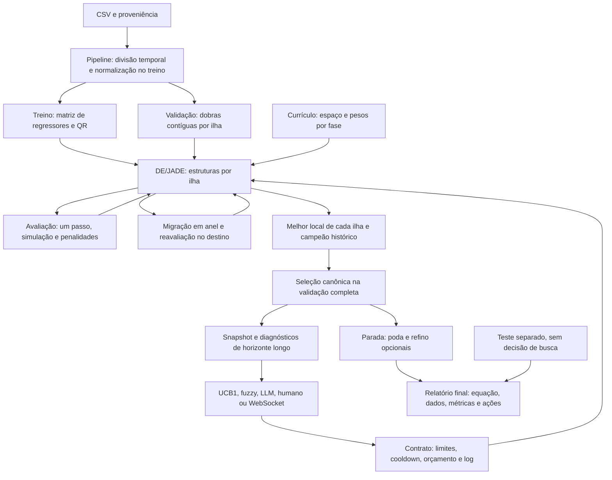

# Arquitetura atual do AEGIS — fluxo confirmado no código

Data: 2026-11-20. Escopo: árvore de trabalho baseada em `9e4b1d8`, núcleo
`1.1.0-audit`. Análise estática; nenhum experimento novo foi executado para
escolher este desenho. O protocolo congelado continua em execução. Este
documento distingue comportamento implementado de interpretação e hipótese.

## 1. A ideia central

**O AEGIS evolui equações NARX interpretáveis, polinomiais e racionais com
expoentes reais e atrasos explícitos, por DE/JADE multi-ilha com papéis,
regimes e currículo, sob supervisão tipada, limitada e auditável de agentes.**

O cromossomo representa estrutura, não uma rede oculta. Cada regressor é um
produto de fatores variável–atraso–expoente, no numerador ou denominador;
coeficientes e intercepto são ajustados numericamente. Expoentes reais
pertencem à representação, mas o experimento atual usa grade de 0,5.

## 2. Fluxo real

| Etapa | Comportamento e evidência no código |
|---|---|
| Entrada | `tool/benchmarks/prepare_benchmarks.dart:113` (CT), `:128` (WH), `:184` (SB); hashes em `docs/BENCHMARKS.md`. WH/SB usam 20 mil amostras de **estimação**, das quais 16 mil são treino e 4 mil validação. |
| Divisão e escala | `cpp/src/identification_pipeline.cpp:397`: índices explícitos prevalecem sobre razões; normalizador ajustado só no treino; transformação afim sem corte. |
| Representação e matriz | `cpp/src/regressor_library.cpp:37`, `:99`, `:131`: produtos, canonicalização e Ψ. `cpp/src/rational_model.cpp:12`: QR com coluna constante; regressores do denominador multiplicados por −y observado. |
| Avaliação | `cpp/src/individual_evaluator.cpp:269`: constrói Ψ no treino uma vez, ajusta coeficientes, calcula ERR, predição na validação e simulação. `:329` estabelece linha de pontuação comum. |
| Objetivo | `cpp/src/individual_evaluator.cpp:97`: soma RMSE, BIC/n, contagem de fatores/denominadores, expoentes, estabilidade empírica e contribuição de entrada; em `simulation`, troca RMSE e BIC e não soma novamente θ·Efr. |
| Variação | `cpp/src/de_optimizer.cpp:185`, `:274`, `:292`, `:330`: JADE ou rand1, mutação estrutural, crossover que cresce/encolhe, seleção gulosa e adaptação. |
| Ilhas | `cpp/src/identification_pipeline.cpp:726`: ciclo balanced/parsimony/free-run/stability. Com três ilhas só os três primeiros papéis estão presentes; não existe uma ilha dedicada a estabilidade no padrão. `:737`: regimes são janelas contíguas de validação com contexto anterior. Não são estados físicos inferidos. |
| Migração | `cpp/src/de_optimizer.cpp:570`: anel, reavaliação sob pesos/regime do destino; exceção de escape descrita abaixo. |
| Campeão | `cpp/src/de_optimizer.cpp:541`, `:557`: cache e comparação canônica dos melhores locais; campeão preservado entre gerações. Não é varredura canônica de toda a população. |
| Currículo | `cpp/src/identification_pipeline.cpp:536`, `:599`, `:708`: início com pmax/atrasos reduzidos; transições por contribuição de entrada/R² e estagnação; perfis de pesos, expansão do espaço e reinícios reflexos. |
| Diagnóstico | `cpp/src/individual_evaluator.cpp:416` e `cpp/src/de_optimizer.cpp:686`: resíduos ACF/CCF, simulação completa da validação, sobre/subajuste e raio espectral linear. Diagnóstico do campeão é cacheado. |
| Agentes | `lib/services/optimization_agent.dart:81`; `tool/experiments/run_agent_experiment.dart:179`: step → snapshot → consulta aguardada → ação entre gerações. UI assíncrona tem outro escalonamento. |
| Contrato | `cpp/src/identification_pipeline.cpp:432`, `:928`, `:1034`: esquema, validação, fila de ações; `:851`: desfecho em janela. Teste não integra a observação. |
| Finalização | `cpp/src/identification_pipeline.cpp:1093`, `:1181`: poda/refino com aceitação canônica, métricas por partição, equação, configuração, normalização e logs. |

## 3. Pontos fracos observados e hipóteses separadas

### A. Ajuste e uso final não otimizam a mesma coisa — prioridade alta

`IndividualEvaluator::evaluate` chama `RationalModel::fit_from_psi` mesmo em
`simulation` (`individual_evaluator.cpp:304`). Este último usa saídas medidas
na matriz e QR (`rational_model.cpp:12`). Mudar o modo de pontuação não
transforma esse ajuste em output error. Em modelos polinomiais com ruído de
saída, os próprios regressores AR também podem sofrer erro nas variáveis.

`LocalRefiner::compute_jacobian` usa `predict_one_step`
(`local_refiner.cpp:31`), e `refine_trf` retorna diretamente em polinomiais
(`:65`). O pipeline só o chama para racionais (`identification_pipeline.cpp:1113`).
O vetor refinado contém apenas `coefficients`; o intercepto fica fixo.
Logo o nome “refinamento local” não significa minimização do erro de simulação.

**Hipótese testável:** refinar coeficientes **e intercepto** por simulação
no treino melhora a estrutura fixa e a seleção subsequente. Não há prova
de que isso baste: capacidade, mínimos locais e orçamento podem dominar.

### B. Horizonte longo informa o painel, mas não veta a escolha

O fitness padrão simula apenas 50 amostras depois da linha comum
(`individual_evaluator.cpp:365`). `diagnose` calcula simulação longa
(`:464`), mas `update_champion_locked` compara `fitness` (`de_optimizer.cpp:557`),
sem usar `free_run_val_diverged` como veto. A possibilidade de detectar o
problema na UI não o impede na seleção.

No CT de desenvolvimento, ilha única e ausência de papéis/regimes tiveram
6/10 divergências no teste, contra 0/10 na referência (handoff §6). Esse teste
já visto é evidência retrospectiva; não será critério de ajuste do novo
desenho. O diário registra que `simulation` sozinho não resolveu na validação.

### C. Parcimônia é imposta por vários termos; a causa do subajuste é incerta

BIC, fatores, expoentes e denominadores penalizam complexidade simultaneamente
(`individual_evaluator.cpp:97`). O currículo impõe pisos de contribuição de
entrada e repondera γ/θ (`identification_pipeline.cpp:536`). Isso mistura
adequação preditiva, preferência e segurança numa escala única. Campeões CT
com quatro parâmetros e resultados de validação estão registrados no diário.

**Hipótese**, não diagnóstico causal: pressão de parcimônia e/ou exploração
insuficiente retém estruturas quase lineares. Só as ablações de seleção,
semeadura e ajuste podem separar essas explicações. A presença de y(k−1)
não é por si um defeito; não se propõe proibi-lo.

Há também limite duro de capacidade: a configuração atual permite oito
regressores, portanto no máximo nove coeficientes com intercepto. Isso
não permite testar a representação de aproximadamente 40 coeficientes
citada pelo usuário. A contagem publicada não inclui todas as escolhas
estruturais do AEGIS. O estudo específico separando teto, γ e ajuste está
em [06_CAPACIDADE_E_AJUSTE.md](06_CAPACIDADE_E_AJUSTE.md).

### D. Contrato de migração tem exceção não documentada

`de_optimizer.cpp:592` filtra por melhora sobre o pior destino; `:597` permite
um “escape valve” quando a origem estagna, aceitando qualquer candidato
finito. `accept_migrants` (`:424`) substitui os piores sem nova comparação.
Portanto a afirmação “sempre melhora no destino” não vale para esse ramo.
O anel também é atualizado sequencialmente: uma ilha pode retransmitir no
mesmo evento um indivíduo recém-recebido. Não alterar o protocolo atual;
propor política explícita e teste na evolução futura.

### E. Contagem de avaliações não mede todo o custo

`de_optimizer.cpp:608` verifica o limite após a geração (`:643`): pode haver
ultrapassagem por um lote. Soma avaliações dos avaliadores de ilhas e
canônico (`:828`), mas diagnósticos completos e o avaliador separado do
pós-processamento (`identification_pipeline.cpp:1096`) não entram nesse total.
Isso não torna inútil o estudo atual; limita a equivalência de custo, sobretudo
se for acrescentado LM, que avalia muitas trajetórias por estrutura.

### F. Cache atual pressupõe ajuste determinístico por estrutura

`Chromosome::full_hash` (`regressor_library.cpp:81`) inclui estrutura,
expoentes e modo de potência, mas não coeficientes nem intercepto. O cache
canônico (`de_optimizer.cpp:541`) é compatível com o QR determinístico atual.
Deixará de identificar o modelo avaliado se forem preservados coeficientes
refinados diferentes para a mesma estrutura. Isso precisa ser resolvido antes
da busca memética; não é uma justificativa para alterar o binário congelado.

### G. Recompensa de agentes e objetivo final divergem

Desfecho do núcleo usa `rmse_val` de um passo, H=25
(`identification_pipeline.cpp:851`); UCB1 usa a mesma família de métrica,
H=50 (`local_adaptive_agent.dart:172`, `:200`); aprendizado fuzzy reconstrói
por padrão simulação longa, H do núcleo (`learn_fuzzy_policy.dart:89`).
São definições diferentes, não um único conjunto intercambiável de recompensas.
Correção por tendência não é contrafactual causal. Ações sobrepostas e mudanças
de fase dificultam atribuição. Resultados CT disponíveis não demonstram ganho
dos supervisores; sementes 11–20 estão descritas em `docs/EXPERIMENTS.md`.

### H. Outras fronteiras a preservar

O raio espectral da parte linear e simulações finitas não provam estabilidade
BIBO global de um NARX não linear. A classificação deve ser “admissível nos
ensaios”, com envelope e horizonte registrados. O fallback Dart e as ligações
WASM não têm paridade completa com o núcleo C++; um novo esquema deve negociar
capacidades, sem anunciar execução de um componente ausente (auditoria P1-14).

## 4. Decisões que esta leitura sustenta

1. Preservar representação, DE/JADE, ilhas, papéis/regimes, migração e agentes.
2. Atacar primeiro a diferença entre ajuste de um passo e uso em simulação.
3. Fazer a admissibilidade longa participar da seleção, com custo explícito.
4. Comparar erro e tamanho separadamente; não multiplicar penalidades novas.
5. Promover agentes a alocadores de tarefas finitas só depois de medir o
   benefício dessas tarefas sob um escalonador determinístico.

Desenho: [03_PROPOSTA_INTEGRADA.md](03_PROPOSTA_INTEGRADA.md). Hipóteses e
gates: [04_PLANO_EXPERIMENTAL.md](04_PLANO_EXPERIMENTAL.md). A evidência acima
é de código e de treino/validação ou de CT já exposto; não foram lidos
resultados de teste WH/SB para decidir a proposta.
