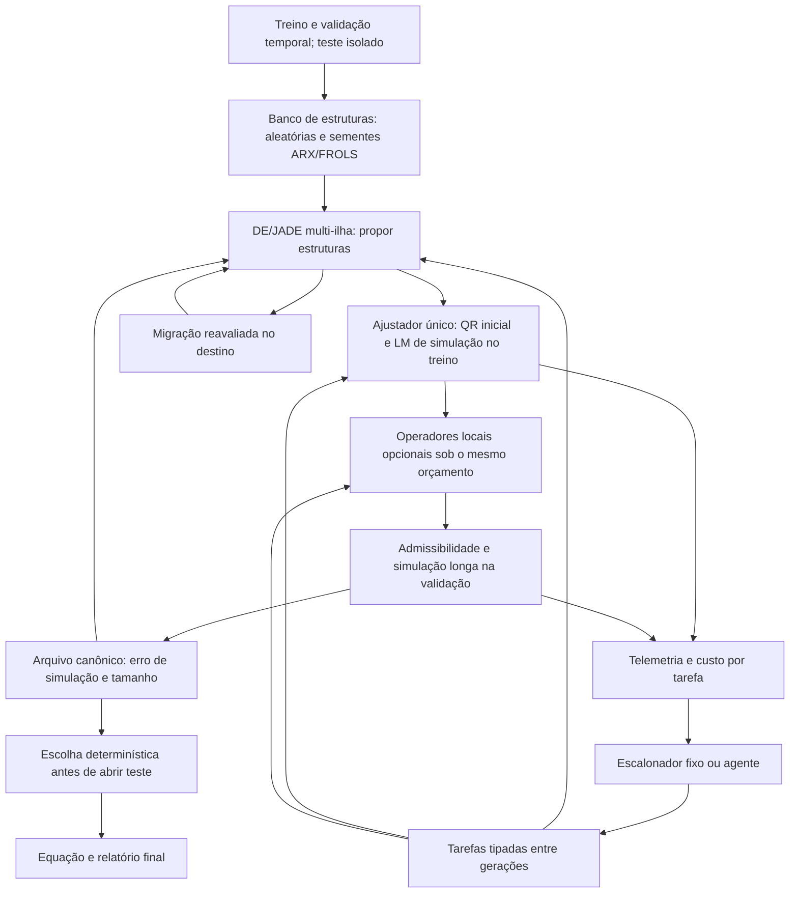

# Proposta integrada — AEGIS orientado à simulação

Data: 2026-11-20. **Desenho para aprovação; não implementado.** Fundamentação:
[arquitetura real](01_ARQUITETURA_ATUAL.md) e [literatura](02_LITERATURA.md),
especialmente a extensão §10–§12. Resultados futuros, inclusive desfavoráveis,
serão julgados pelo [plano experimental](04_PLANO_EXPERIMENTAL.md).

## 1. Uma frase antes e depois

**Hoje:** o AEGIS evolui equações NARX interpretáveis, polinomiais e racionais
com expoentes reais e atrasos explícitos, por DE/JADE multi-ilha com papéis,
regimes e currículo, sob supervisão tipada, limitada e auditável de agentes.

**Proposto:** o AEGIS evolui essas mesmas equações por DE/JADE multi-ilha,
ajustando seus coeficientes por simulação e selecionando equações admissíveis
no compromisso erro–tamanho, com currículo e agentes que distribuem um
orçamento fixo entre exploração e refinamento auditáveis.

A mudança central é **alinhar o ajuste interno e a seleção externa ao uso
em simulação**. QR, semeadura e operadores locais servem a essa cadeia; não
são identificadores finais concorrentes. A equação exportada continua sendo
um único NARX explícito, sem ensemble ou estado neural escondido.

## 2. Fronteiras dos componentes

Contrato novo de avaliação: `FitResult` contém estrutura, θ, intercepto,
loss de treino por horizonte, convergência, falhas e custo. `EvaluationResult`
contém métricas da validação por contexto, admissibilidade e identidade do
modelo. `SearchContext` identifica split, normalizador, fase, janelas,
versão do ajustador e orçamento. Validação **seleciona** e nunca fornece
gradientes ou passos do ajustador. Teste só entra no avaliador final.

## 3. Ajustador por erro de simulação — componente obrigatório da proposta

**Problema:** modo `simulation` atual pontua modelos cujos coeficientes foram
ajustados por QR de um passo; refino atual não corrige isso (§3.A da arquitetura).

Para estrutura S fixa, minimizar no treino:

\[
J_H(\vartheta;S)=\frac{1}{\sum_b |W_b|}
 \sum_b\sum_{k\in W_b}(y_k-\hat y^{S,\vartheta}_{b,k})^2,
\qquad \vartheta=(c,\theta_N,\theta_D).
\]

Os blocos têm contexto medido anterior suficiente para os atrasos; dentro de
cada bloco as saídas são exclusivamente recursivas. A normalização e a
escala da loss vêm do treino. O primeiro bloco nunca busca contexto em uma
partição futura. O cronograma H=50 → 200 → treino completo é definido pelo
orçamento consumido, não pelo resultado do teste. Se um bloco não couber,
usa-se o comprimento disponível; as regras exatas estão no plano.

1. QR continua como inicialização barata e fallback identificado.
2. LM amortecido otimiza **intercepto e todos os coeficientes**, tanto em
   polinomiais como em racionais; não muda expoentes nem atrasos.
3. Jacobiano inicial por diferenças finitas centrais, em ordem fixa; cada
   perturbação é debitada. Resolver o sistema amortecido por QR, sem formar
   inversa explícita. Passo/escala e tolerâncias são versionados.
4. Trajetória não finita, cruzamento de denominador ou limite excedido não
   usa a saída saturada como resíduo diferenciável: rejeita o passo, aumenta
   amortecimento e consome o custo já gasto. Nenhum “melhor” resultado é
   fabricado ao abortar. Guardar o último ajuste finito e o motivo da parada.
5. H curto serve de continuação numérica; só trajetórias longas qualificam
   um candidato para o arquivo final. Reinícios dentro do treino não são
   apresentados como simulação livre longa.

**Substitui:** `LocalRefiner` de um passo como refinador padrão futuro e o
refit automático escondido em toda avaliação. Separar `fit(S, treino)` de
`score(S, θ, contexto)`; migração e pontuação canônica preservam θ e c.
O modo antigo permanece apenas em configuração de reprodução.

**Custo:** para q coeficientes, uma iteração de diferenças centrais exige
aproximadamente 2q+1 trajetórias, além das tentativas de passo e QR. Custo
de simulação cresce com amostras × fatores; não é “uma avaliação” comparável
ao QR anterior. Refino é reservado a candidatos promovidos, não a todo trial.

**Riscos:** mínimos locais, ruído nos contextos medidos, expoentes fracionários
e denominadores quase singulares. O LM pode não melhorar; estrutura ruim não
se conserta ajustando θ. **Alternativas:** simulação completa desde o início
é ablação; multiple shooting com estados de fronteira livres fica adiado
porque acrescenta variáveis e regularização de continuidade. O desenho
inicial usa blocos com história medida, sem chamar isso de implementação
do TSEM/encoder de outros autores. Não se incorpora uma rede para estimar
estados, nem se presume que o ganho publicado se transfere ao NARX.

## 4. Admissibilidade e arquivo erro–tamanho

**Problema:** a soma ponderada admite trocar divergência por parcimônia;
diagnóstico longo atual não veta o campeão. Múltiplas penalidades também
dificultam medir a causa do modelo quase linear.

**Papel:** substituir o seletor canônico escalar por um arquivo limitado de
candidatos **admissíveis** e não dominados em `(E_sim,val completo, K)`.
K é número de coeficientes incluindo intercepto; fatores, expoentes e maior
atraso continuam registrados e servem de desempate, não de novas metas.

Admissibilidade exige simulação longa finita no treino e validação,
envelope definido pelo treino, margem de denominador ≥0,1 na escala do
denominador com constante 1, sem mudança de sinal nas trajetórias avaliadas.
Usar os limites atuais como primeira especificação, declarando sua natureza
heurística. A checagem usa denominador bruto antes do clamp numérico.
Modelos rejeitados continuam no log e na taxa de falha.

**Não é certificado de estabilidade global.** O raio espectral linear e
ACF/CCF são diagnósticos. Não impor contração global como condição inicial:
isso pode excluir dinâmicas válidas e altera fortemente a classe de modelos.

Arquivo com no máximo 64 modelos, uma identidade por `(S, θ, c, contexto)`;
reter menor erro para cada K, depois remover pontos dominados. Em igualdade,
preferir menos fatores, menor atraso e ordem lexicográfica da serialização.
Assim o arquivo não depende de ordem de threads ou de hash com colisão.

**Escolha final:** menor K entre admissíveis com erro até 1% acima do menor
erro de validação do arquivo; desempatar por erro, fatores, atraso e
serialização. A tolerância é uma preferência prévia, não estimativa de ruído.
Se nenhum modelo for admissível, declarar falha de identificação; registrar
o melhor candidato inválido separadamente, sem chamá-lo de campeão válido.

**O que deixa de existir no caminho novo:** soma canônica de BIC, fatores,
expoentes e contagem de denominadores; penalidade que compra estabilidade;
penalidade de contribuição de entrada usada para decidir o campeão. ERR e
contribuição continuam como diagnósticos e guias de propostas. Papéis de ilha
continuam: equilíbrio, parcimônia e fidelidade usam preferências locais
fixadas sobre as mesmas métricas; papel de estabilidade prioriza margem e
taxa de admissibilidade. Regimes continuam dobras temporais, com validação
completa no arquivo canônico. Não se acrescenta NSGA-II como segundo motor.

**Custo/risco:** checagem longa custa O(N·fatores); arquivo pode multiplicar
avaliações e superexplorar validação. Promoção periódica e teto do arquivo
limitam custo, mas só orçamento e confirmação reservada testam generalização.
Seleção escalar com um único termo de tamanho é a alternativa de ablação;
não se afirma que Pareto é necessariamente melhor.

## 5. Busca memética e semeadura — componentes isoláveis

### 5.1 Sementes informadas, sem substituir DE

**Problema:** estruturas aleatórias podem gastar orçamento para redescobrir
atrasos lineares ou termos simples. Evidência da eficiência de semear é da
literatura, ainda não é um resultado do AEGIS.

Inserir até 20% da população inicial com ARX e estruturas FROLS de treino,
em tamanhos distintos; pelo menos 80% permanece aleatória. Mesma gramática
do AEGIS, intercepto explícito e limites atuais. Sementes que excedem limites
não são truncadas silenciosamente: não são admitidas. Não aumentar
`maxRegressors` só para encaixar o baseline FROLS de 24 termos de WH.

FROLS usa um dicionário pequeno, univariado, atrasos 1–10 e graus 1–3,
somente polinomial; é um gerador de propostas, não restringe as estruturas
racionais/reais que DE pode descobrir depois. QR/ERR compartilham o mesmo
serviço numérico e contador. Análise de correlação serve apenas para ordenar
propostas, sem cortar atrasos de correlação pequena (não linearidade pode
ter correlação linear nula).

**Custo/risco:** construir e ortogonalizar o dicionário custa O(N·M·k);
redução de diversidade e viés linear são riscos medidos em ablação. BLA
frequencial não entra inicialmente: exige tratamento de excitação/períodos
e conversão para NARX. ARX não será denominado BLA sem essa estimação.

### 5.2 Operador local sobre a estrutura

**Problema:** poda só no final não permite que uma melhoria local gere
descendentes; no CT não alterou o campeão. Isso não prova que poda é inútil.

Promover no máximo um candidato por ilha a cada janela de tarefas para
um movimento de remoção/inserção/troca, ordenado por ERR no treino. O
ajustador único refaz QR e, se houver verba, LM. Aceitar segundo a preferência
local e enviar admissíveis ao arquivo global; nunca aceitar só por ERR.
Após mudança estrutural, invalidar identidade dos coeficientes anteriores.

**Substitui:** a poda independente e gratuita ao final. Não há uma segunda
busca FROLS completa em cada geração; sementes e movimento local reutilizam
o mesmo dicionário/serviço. Custo de cada vizinho e ajuste é debitado.
Risco de convergência prematura exige limite de tarefas e ablação sem operador.

## 6. Currículo e supervisores com uma única autoridade de orçamento

Currículo permanece como progressão de dificuldade: exploração/QR → refino
de simulação curto → longo → consolidação. Seus marcos dependem da fração
do orçamento, com uma máquina de estados monotônica. Nenhuma mudança de
fase altera retroativamente a métrica do arquivo: scores carregam contexto
e são revalidados antes da comparação. O arquivo final sempre usa horizonte
longo e a mesma regra de admissibilidade.

Primeiro implementar um escalonador determinístico fixo. Agentes só depois
escolhem entre **tarefas com limite de trabalho**, mantendo o mesmo teto:

| Tarefa proposta | Efeito e limite | Crédito observável |
|---|---|---|
| `refineCandidate` | S e θ existentes, treino, cota fixa de LM | mudança de E_sim e admissibilidade por unidade de trabalho |
| `localStructureMove` | um vizinho, ajuste debitado, ilha identificada | inclusão/substituição no arquivo |
| `restartIsland` | fração ≤0,2 dos não elites; mínimo 50 gerações entre reinícios | diversidade e erro após janela isolada |
| `advancePhase` | somente fase seguinte, janela permitida e verba restante | janela inconclusiva para comparar ações simultâneas |
| `noAction` | conserva verba para DE | referência explícita |

Não autorizar agentes a aumentar o orçamento global, trocar dados,
normalização, tolerância final ou critério de segurança. “Alocar orçamento”
significa redistribuir uma cota preexistente. `allowBudgetActions=false`
continua bloqueando extensões; o novo alocador valida soma de cotas.

Introduzir `aegis.observation/2`, `aegis.action/2` e capabilities. A observação
inclui erro longo canônico, tamanho, rejeições por segurança, diversidade,
créditos por tarefa, contexto e saldo. Sempre sem teste. Núcleo publica o
esquema; Dart e LLM não mantêm cópias divergentes dos limites. Clientes v1
continuam no caminho antigo; ação v2 em backend sem capacidade é rejeitada,
sem conversão silenciosa. Kill switch, limites, ordem entre gerações e
registro de recusas permanecem.

Uma tarefa por janela de crédito; conclusão após trabalho equivalente fixo,
não 25 gerações de custos diferentes. A recompensa principal passa a ser
melhora relativa da mesma E_sim longa canônica por crédito, com variação
de tendência registrada separadamente. Mudança de fase, restart reflexo ou
outra intervenção torna o crédito inconclusivo. Avaliação causal requer
ablação/randomização; o score da trajetória não a substitui.

LLM permanece opcional e só sugere tarefas do mesmo catálogo: sem geração
ou execução livre de código. Nenhuma chamada paga nesta tarefa. Política
neural adiada por falta de evidência. UCB1/fuzzy existentes são controles,
não justificativa para treinar uma política mais complexa.

## 7. Reprodutibilidade e identidade

Separar `StructureId` de `FittedModelId`: este último inclui S, θ, c,
normalizador, dados de treino, versão e parâmetros do ajustador. `ScoreId`
acrescenta split, horizonte, linha inicial e limites. Hash é índice, não
prova de igualdade: comparar payload canônico em colisões. Cache nunca
retorna θ de outro ajuste da mesma estrutura. Migração preserva o modelo
ajustado e reavalia o destino; refit é uma tarefa explícita paga.

Substreams RNG independentes e derivados de `(seed, island, task, id)`;
ordem de tarefas e redução determinísticas; registrar propostas e respostas,
inclusive LLM, para replay sem API. Replay determinístico não promete que
consultas LLM novas devolvam a mesma resposta. CPU/compilador/precisão são
parte do manifesto; não prometer igualdade bit a bit entre backends.

Todas as tarefas, inicialização, diagnósticos, promoções e pós-processamento
usam o mesmo contador; verificar saldo **antes** da tarefa. Reservar cota
final de certificação, sem finalizar um modelo nunca validado por falta de
verba. Preservar binários/configurações do estudo 1.1.0; nova implementação
em diretório de build e diretório de resultados próprios.

## 8. Teste de coerência: o que não incorporar

| Não incorporar inicialmente | Motivo e alternativa |
|---|---|
| Rede de estados, LSTM, GP residual, ensemble ou modelo físico CT como saída principal | muda a classe e a equação central; usar como referência externa, sem copiar seus números como ganho esperado |
| Multiple shooting com estados livres + encoder + SCI simultâneos | três soluções para condicionamento/estado inicial; começar por blocos com história medida e LM, medir falhas antes de acrescentar estados |
| NSGA-II, MOEA/D e DE concorrentes | redundância no motor global; manter DE e arquivo de duas metas |
| Estabilidade como terceiro objetivo negociável | divergência não deve ser trocada por menos termos; tratá-la como admissibilidade empírica |
| Penalidades BIC + fatores + expoentes + denominadores no seletor novo | recompõem a mesma soma difícil de interpretar; duas metas com desempate explícito |
| FROLS completo em cada geração + poda final separada | custo redundante; um serviço de propostas, acionado como tarefa |
| Busca de arquitetura/modelo livre por LLM, como ASIA | fora da ideia central e do contrato reproduzível; catálogo fechado de tarefas |
| Contração global ou clipping da saída para “garantir estabilidade” | pode excluir sistemas válidos ou esconder falhas; medir trajetórias e declarar limite da evidência |

Cada componente tem uma responsabilidade: **DE propõe estrutura; ajustador
estima θ; validador qualifica; arquivo escolhe o compromisso; supervisor
distribui trabalho.** Semear e mover localmente são maneiras de propor S,
não exceções a essa sequência. O pacote completo só é recomendado se cada
componente sobreviver às ablações; um componente sem contribuição é removido.

## 9. Recomendação e decisão de aprovação

**Complemento do usuário:** [06_CAPACIDADE_E_AJUSTE.md](06_CAPACIDADE_E_AJUSTE.md)
passa a integrar este desenho. Antes de fixar o limite de tamanho do motor
futuro, medir capacidade × penalidade de fatores × ajuste (QR/LM). O limite
atual de nove coeficientes não alcança a base de aproximadamente 40 colunas
da referência pNARX. A associação entre resultados baixos e treino por
simulação motiva o ajustador, mas não elimina capacidade, condicionamento,
suporte temporal ou física como explicações alternativas.

Aprovar primeiro a infraestrutura de custo/identidade, o ajustador de
simulação e a admissibilidade longa; depois comparar o seletor de duas metas.
Semear, busca local e agentes entram separadamente após esses gates. A lista
executável em pequenos passos está em
[05_IMPLEMENTACAO_PRIORIZADA.md](05_IMPLEMENTACAO_PRIORIZADA.md).

Espera-se reduzir o desencontro entre o problema ajustado e o avaliado e
evitar escolher modelos que já falham na validação longa. **Não há estimativa
honesta de ganho em V ou mV** sem executar o plano; custo pode aumentar e o
erro pode não melhorar. Nenhuma superioridade sobre a literatura é prometida.
Esta aprovação diz respeito ao desenho e à futura implementação local;
não autoriza chamadas pagas, publicação nem ajuste após abrir testes.
